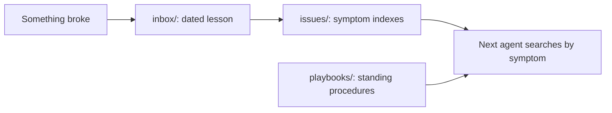

# `.agents/` — what agents have learned working on this repo

Shared memory for the AI agents (and people) who maintain GraphDone-Core. When
something goes wrong, the lesson is written down here with its evidence, so the
next agent finds it before repeating the mistake. [`AGENTS.md`](../AGENTS.md)
says how to use it.

## What's here

| Path | What it is |
| --- | --- |
| [`inbox/`](inbox/README.md) | One file per lesson: `YYYY-MM-DD-<lesson>.md` with evidence, cause, rule and limits |
| [`issues/`](issues/README.md) | Symptom indexes that point from what you see to the lesson and its regression test |
| [`playbooks/`](playbooks/README.md) | Durable procedures, such as how changes are integrated into `dev` |

Up: [repository root](../README.md)
