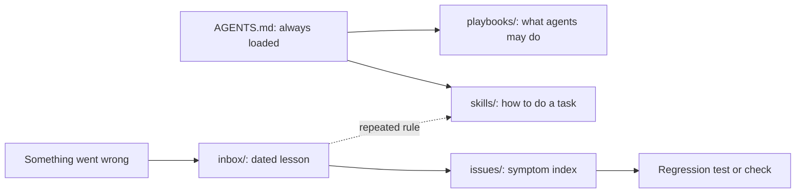

# `.agents/` — guidance for the agents that maintain this repo

What AI agents (and people) need beyond the code to work here safely: how to do
recurring tasks, what agents may do, and what went wrong before. It is shared
across harnesses: Codex reads `skills/` natively, and Claude Code reads it
through the `.claude/skills` link. [`AGENTS.md`](../AGENTS.md), loaded in every
session, is the entry point.

## What's here

| Path | What it holds |
| --- | --- |
| [`skills/`](skills/README.md) | Procedures for recurring tasks, one `SKILL.md` per folder (Agent Skills format) |
| [`playbooks/`](playbooks/README.md) | Policy: what agents may do and the validation bar, such as integrating into `dev` |
| [`inbox/`](inbox/README.md) | One dated lesson per incident: evidence, cause, rule, limits |
| [`issues/`](issues/README.md) | Symptom indexes from what you observe to the lesson and its test |

## Keeping it useful, not a pile

Every line here is read by future agents, so guidance has to earn its place and
leave when it stops being true. The procedure is the
[`improve-agents-folder`](skills/improve-agents-folder/SKILL.md) skill; the rules:

1. **Search first, then improve the existing entry.** Add a new one only when
   nothing covers it.
2. **Prefer a check to prose.** If a program can enforce a rule, put it in a
   test or contract; a lesson only records why.
3. **Promote repeated rules.** A rule three lessons share becomes one line in a
   skill or `AGENTS.md`; lessons that only repeat it are deleted.
4. **Delete what is stale or duplicated** in the same PR that makes it so. Git
   keeps history; nothing is archived in the tree.
5. **Never here:** status reports, plans, TODOs, session logs, copies of docs,
   personal notes, generated output, secrets or private names. Those belong in
   GitHub issues, PRs or `docs/`.
6. **Same review as code.** Guidance changes land through PRs that say what was
   added, merged and deleted.

`tests/toolchain/agents-contract.mjs` enforces the mechanical part:
- **Allowed contents:** only these four folders and this README.
- **Lessons:** dated file names, and each one linked from an index.
- **Skills:** each has a valid `name` and `description`, and stays under 150 lines.
- **Size:** `AGENTS.md` stays under 200 lines.
- **Links:** every relative link resolves.
- **Wiring:** `CLAUDE.md` imports `AGENTS.md`, and `.claude/skills` links here.

Up: [repository root](../README.md)
