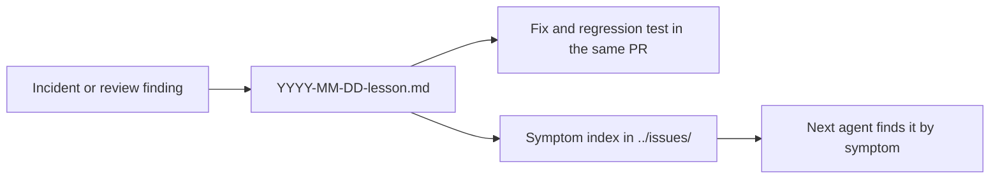

# `.agents/inbox/` — dated lessons

One Markdown file per incident or review finding. Each lesson records what went
wrong with dated evidence, why it happened, the rule that now prevents it, and
what the fix does *not* cover. They are the reasoning behind many of the tests
and guards in this repo: when a check looks oddly strict, the lesson that
introduced it is usually here.

## Finding a lesson

Search by what you see, not by file name: start at the
[symptom index](../issues/INDEX.md), or search this folder for an error message,
test name or file path. Lessons so far cover:

| Topic | Example lessons |
| --- | --- |
| Graph rendering, LOD and layout | `2026-10-29-high-degree-detail-needs-local-lod.md`, `2026-11-07-fit-must-measure-presented-geometry.md`, `2026-11-10-layouts-must-leave-label-room.md` |
| Interaction and focus | `2026-10-28-drag-mode-must-survive-modifier-release.md`, `2026-10-27-delayed-autofocus-must-preserve-chosen-focus.md` |
| Auth and security | `2026-10-23-magic-link-consumption.md`, `2026-10-27-captcha-proof-must-be-server-issued.md` |
| Releases, CI and dependencies | `2026-10-23-release-gates-must-fail-closed.md`, `2026-10-28-advisories-follow-installed-consumers.md` |
| Test evidence and fixtures | `2026-10-28-browser-evidence-needs-files.md`, `2026-10-27-disposable-git-fixtures-must-own-maintenance.md` |

## Adding one

Name it `YYYY-MM-DD-<what-must-be-true>.md` (the rule, not the bug). Use the
sections the existing lessons use: a one-paragraph summary, **Evidence** (exact
commands, commit and observed results), **Cause and corrective rule**, and
**Limits**. Link it from the matching index in [`../issues/`](../issues/README.md)
and land it in the same pull request as the fix. Do not rewrite a lesson's
evidence after the fact. When two lessons state the same rule, merge them into
the clearer one; when a rule is promoted into a skill or `AGENTS.md`, or the code
it guards is gone, delete the lesson and its index row in that PR (see
[`improve-agents-folder`](../skills/improve-agents-folder/SKILL.md)).

Up: [`.agents/`](../README.md)
