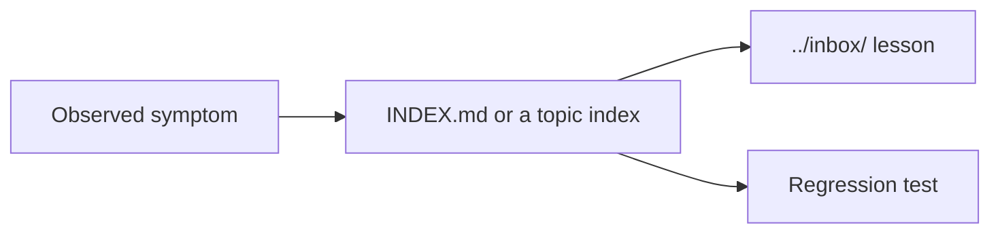

# `.agents/issues/` — symptom indexes

Lookup tables from a symptom you can observe ("the header count is stale after
deleting a link") to the lesson that explains it and the test that guards it.
Search here before debugging or adding new guidance.

## What's here

| File | What it indexes |
| --- | --- |
| [`INDEX.md`](INDEX.md) | The main symptom index across all areas |
| [`browser-startup-index.md`](browser-startup-index.md) | Browser launch and startup failures |
| [`magic-link-index.md`](magic-link-index.md) | Email magic-link sign-in |
| [`mobile-touch-index.md`](mobile-touch-index.md) | Phone and tablet touch behaviour |
| [`password-login-index.md`](password-login-index.md) | Password login and its limits |
| [`performance-evidence-index.md`](performance-evidence-index.md) | Performance gates and evidence |
| [`responsive-acceptance-index.md`](responsive-acceptance-index.md) | Layout across screen sizes |
| [`security-audit-index.md`](security-audit-index.md) | Dependency advisories and security audits |

Up: [`.agents/`](../README.md)
