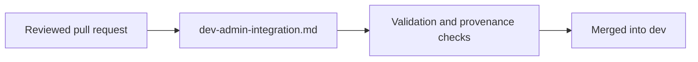

# `.agents/playbooks/` — standing procedures

Step-by-step procedures that stay true across many changes, as opposed to the
one-off lessons in [`../inbox/`](../inbox/README.md).

## What's here

| File | What it is |
| --- | --- |
| [`dev-admin-integration.md`](dev-admin-integration.md) | How maintainer agents integrate reviewed changes into `dev` under the owner's standing authorization: review, validation, exact-head merge and reporting |

Up: [`.agents/`](../README.md)
