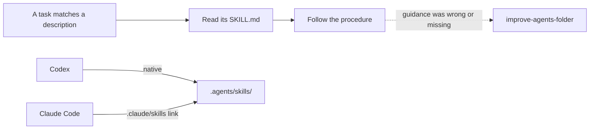

# `.agents/skills/` — how to do recurring tasks here

Each folder is one skill in the open Agent Skills format: a `SKILL.md` with a
`name` and a `description` that says when to use it, followed by the procedure.
Codex discovers this folder on its own. Claude Code reads it through the
`.claude/skills` link, so skills appear in its skill list too. Any other agent
finds them through the table in [`AGENTS.md`](../../AGENTS.md#skills).

## What's here

| Skill | Use when |
| --- | --- |
| [`improve-agents-folder`](improve-agents-folder/SKILL.md) | Adding, changing or retiring agent guidance |
| [`folder-readme`](folder-readme/SKILL.md) | Creating or changing a folder, or a README is missing or stale |
| [`run-journeys`](run-journeys/SKILL.md) | Measuring how reliably basic tasks work per path and device |
| [`release-core`](release-core/SKILL.md) | The owner has asked for a Core release |

Add a skill only for a task agents repeat; see
[`improve-agents-folder`](improve-agents-folder/SKILL.md). Skill folders hold
their `SKILL.md` (and any scripts it runs) and need no README of their own.

Up: [`.agents/`](../README.md)
