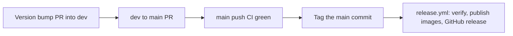

# Release GraphDone Core

A release publishes container images and a GitHub release from a `v*` tag on
`main`. Do this only on the owner's explicit instruction for this release; the
standing authority in `AGENTS.md` covers `dev` only. Gates and their reasons:
[`docs/quality/RELEASE_GATES.md`](../../../docs/quality/RELEASE_GATES.md).



On `main` and for tags: no `--admin` merges, no bypasses and no protection
changes. If a check, review or ruleset blocks you, stop and report to the owner.

## 1. Bump the version (PR into dev)

```bash
scripts/update-version-minimal.sh 0.4.4-alpha
node --test tests/toolchain/version-contract.mjs
```

The script edits every recorded copy (manifests and lockfile entries, runtime
version strings, installer fallback, compose image tags, README badge) and
runs the contract, which fails if any copy was missed. Land it like any other
change, following the [dev integration playbook](../../playbooks/dev-admin-integration.md).

## 2. Promote dev to main

Open a PR from `dev` into `main` and wait for every required check. Never use
`--delete-branch` on a release merge: `dev` must survive. After merging, wait
for the CI run triggered by the push to `main` and confirm it passed for that
exact commit.

## 3. Tag the main commit

```bash
git fetch origin
git tag -a v0.4.4-alpha <main merge sha> -m "GraphDone v0.4.4-alpha"
git push origin v0.4.4-alpha
```

`release.yml` runs `scripts/verify-release.mjs`, which refuses a tag that is not
a commit `main` was at, whose `main` checks did not pass, or whose package
versions differ from the tag. Then it builds and publishes the images and the
GitHub release, and moves `latest` when appropriate.

## 4. Check it

- The release run succeeded and the GitHub release exists with notes.
- The images for the version exist for each architecture.
- Report the tag, commit and run links to the owner. Deploying the hosted site
  is a separate step in the hosted build's own repository.
