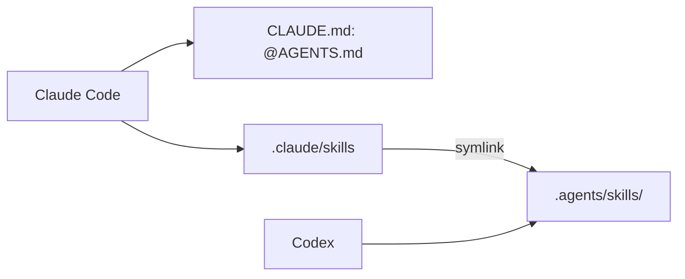

# `.claude/` — Claude Code project settings

Claude Code reads this folder for project-wide configuration that is shared
with everyone working on the repository. The agent guidance itself lives in
[`.agents/`](../.agents/README.md) so that every harness can use it; this
folder only connects Claude Code to it.

## What's here

| Path | What it is |
| --- | --- |
| `skills` | A symlink to [`../.agents/skills/`](../.agents/skills/README.md), so Claude Code lists the shared skills natively |

Only `skills` is a link. `.claude/` itself must stay a real folder, because
Claude Code refuses to create worktrees under a symlinked `.claude`. Shared
Claude-only configuration, such as `settings.json`, subagents in `agents/`
or path-scoped `rules/`, can be committed here when it is needed. Per-user
files (`settings.local.json`, `worktrees/`, `*.lock`) are git-ignored.

On Windows, git creates symlinks only with Developer Mode or `core.symlinks`
enabled; otherwise use the [`AGENTS.md` skills table](../AGENTS.md#skills).

Up: [repository root](../README.md)
