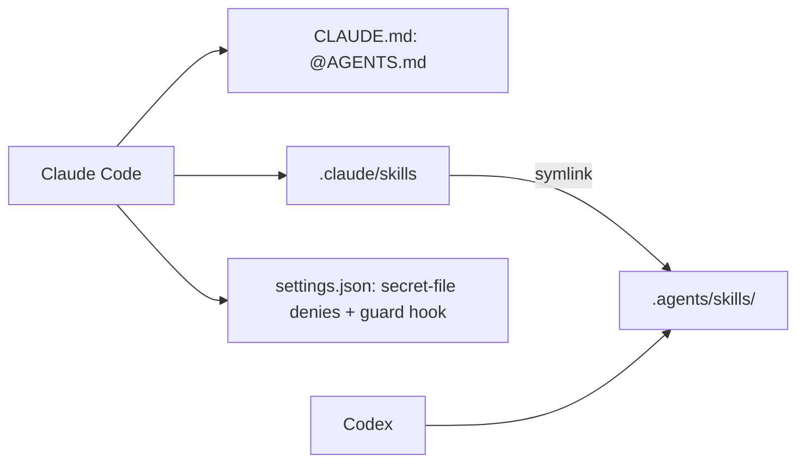

# `.claude/` — Claude Code project settings

Claude Code reads this folder for project-wide configuration that is shared
with everyone working on the repository. The agent guidance itself lives in
[`.agents/`](../.agents/README.md) so that every harness can use it; this
folder only connects Claude Code to it.

## What's here

| Path | What it is |
| --- | --- |
| `skills` | A symlink to [`../.agents/skills/`](../.agents/skills/README.md), so Claude Code lists the shared skills natively |
| [`settings.json`](settings.json) | Shared settings: denies the Read tool on local secret files at any depth (`.env`, `.env.local`, `.env.*.local`, `.env.vm`, `deployment/certs/`; `./start` writes OAuth and JWT secrets into `packages/server/.env`) and runs the guard hook on every Bash call. Use the `.env.example` files to learn what a setting is |
| [`hooks/`](hooks/README.md) | `guard-git.mjs`: blocks force-pushes, deleting `dev`/`main`, `--delete-branch` merges, `--admin` merges outside `dev` and branch-protection changes, and keeps `pr-reviewer` read-only |
| [`agents/`](agents/README.md) | `pr-reviewer`: the independent, read-only PR reviewer, built on the `review-pr` skill |

**Start Claude Code at the repository root.** Claude Code 2.1.322 loads
`settings.json` only for a session started in this folder's parent; a session
started in a subfolder (say `packages/web`) gets neither the denies nor the hook.
Both are guard rails, not a sandbox: Bash can still `cat` a file the Read tool may
not read, so the rules in [`AGENTS.md`](../AGENTS.md) still apply.

Only `skills` is a link. `.claude/` itself must stay a real folder, because
Claude Code refuses to create worktrees under a symlinked `.claude`. Everything
else Claude writes here (personal `settings.local.json`, `worktrees/`, locks,
local memory) is git-ignored: `.gitignore` allowlists the shared entries, so a
new shared entry must be added there first. Put procedures in `.agents/skills/`,
not here, so every harness can use them.

On Windows, git creates symlinks only with Developer Mode or `core.symlinks`
enabled; otherwise use the [`AGENTS.md` skills table](../AGENTS.md#skills).

Up: [repository root](../README.md)
