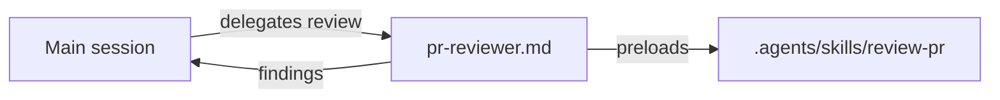

# `.claude/agents/` — Claude Code subagents

Subagent definitions Claude Code can start for a focused job, each with its own
tools and model. Keep the procedure in a shared skill in
[`.agents/skills/`](../../.agents/skills/README.md) and make the subagent a thin
wrapper that preloads it, so agents in other harnesses can follow the same
procedure. (Claude Code skips this README because it has no frontmatter.)

## What's here

| File | What it is |
| --- | --- |
| [`pr-reviewer.md`](pr-reviewer.md) | The independent, read-only PR reviewer the dev integration playbook requires before a merge; runs the [`review-pr`](../../.agents/skills/review-pr/SKILL.md) skill on Opus |

Up: [`.claude/`](../README.md)
