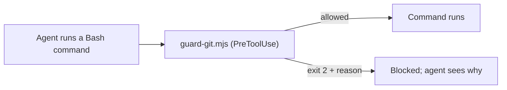

# `.claude/hooks/` — guard scripts Claude Code runs on tool calls

Scripts wired up in [`../settings.json`](../settings.json). They turn the
"never do this" rules in [`AGENTS.md`](../../AGENTS.md) into checks Claude Code
enforces, so a rule holds even when an agent forgets it.

## What's here

| File | What it blocks |
| --- | --- |
| [`guard-git.mjs`](guard-git.mjs) | Force-pushes (`--force`, `-f`, `--force-with-lease`, `+` refspecs, `--mirror`, `--prune`), deleting or rewriting `dev` or `main` (by push or `gh api`), `gh pr merge --delete-branch`/`-d`, `gh repo edit`, and branch-protection or ruleset writes (REST or GraphQL) |

The hook reads a command the way a shell splits it: text inside quotes or a
here-document (a commit message, a PR body) is never treated as a command, while
`;`, `&&`, `|`, subshells and `bash -c` are. It is best-effort, not a sandbox: it
cannot see through `eval`, aliases or scripts, and it lets the command run if its
input is unreadable or `node` is missing. Like `settings.json`, it applies only
to sessions started at the repository root.

The blocking rules are unit-tested in
[`tests/toolchain/agents-contract.mjs`](../../tests/toolchain/agents-contract.mjs)
(blocked and allowed examples). To change what is blocked, change the script
and those tests together. Hooks protect Claude Code sessions only; other
harnesses follow the same rules from `AGENTS.md`.

Up: [`.claude/`](../README.md)
