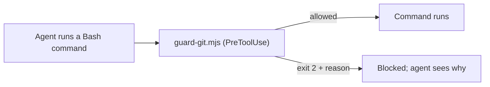

# `.claude/hooks/` — guard scripts Claude Code runs on tool calls

Scripts wired up in [`../settings.json`](../settings.json). They turn the
"never do this" rules in [`AGENTS.md`](../../AGENTS.md) into checks Claude Code
enforces, so a rule holds even when an agent forgets it.

## What's here

| File | What it blocks |
| --- | --- |
| [`guard-git.mjs`](guard-git.mjs) | Force-pushes (`--force`, `-f`, `--force-with-lease`, `+` refspecs), deleting `dev` or `main`, `gh pr merge --delete-branch`, and `gh api` writes to branch protection or rulesets |

The blocking rules are unit-tested in
[`tests/toolchain/agents-contract.mjs`](../../tests/toolchain/agents-contract.mjs)
(blocked and allowed examples). To change what is blocked, change the script
and those tests together. Hooks protect Claude Code sessions only; other
harnesses follow the same rules from `AGENTS.md`.

Up: [`.claude/`](../README.md)
