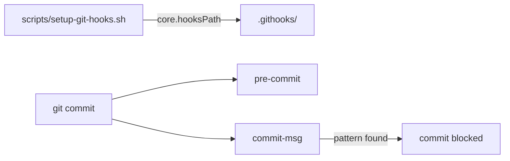

# `.githooks/` — optional local git hooks

Git hooks you can opt into locally. Git ignores them until you point it here with
`scripts/setup-git-hooks.sh`, which runs `git config core.hooksPath .githooks`.

## What's here

| File | What it does |
| --- | --- |
| [`pre-commit`](pre-commit) | Looks for `Co-Authored-By:` lines in staged content and the commit template |
| [`commit-msg`](commit-msg) | Rejects a commit whose message contains co-author or pair-programming attribution |

These hooks are not installed by default, and CI does not run them.

Up: [repository root](../README.md)
