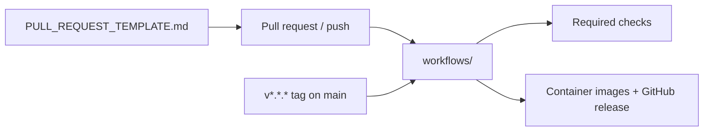

# `.github/` — GitHub configuration

Everything GitHub reads from the repository itself: the CI workflows that test
every push and pull request, the release workflow that publishes images, and the
template every pull request starts from.

## What's here

| Path | What it is |
| --- | --- |
| [`workflows/`](workflows/README.md) | CI, comprehensive tests, Docker build validation and the tag-driven release |
| [`PULL_REQUEST_TEMPLATE.md`](PULL_REQUEST_TEMPLATE.md) | The checklist every pull request description starts from |

graphdone.com is deployed from the hosted build, not from this repository.

Up: [repository root](../README.md)
