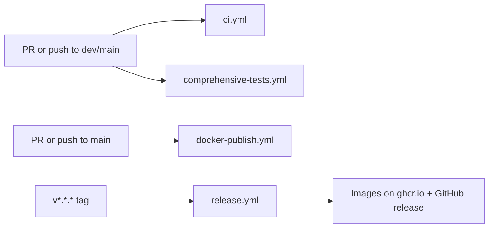

# `.github/workflows/` — CI and release pipelines

GitHub Actions workflows. They decide whether a pull request can merge and they
publish a release when a version tag is pushed on `main`.

## What's here

| File | Runs on | What it does |
| --- | --- | --- |
| [`ci.yml`](ci.yml) | push to `main`/`dev`, every PR, nightly, manual | Lint & type check, unit tests per package, MCP contract against a real Neo4j, build, security scan, the Smoke Gate, UI fit on iPhone/iPad/desktop, showcase report, runtime images, and the production-stack smoke (nightly, manual, or when `main` is involved); `CI Success` sums them up |
| [`comprehensive-tests.yml`](comprehensive-tests.yml) | push to `main`/`dev`, every PR, daily, manual | Unit tests on Node 22.18.0 and 24.x, installer and deploy-config checks, a combined report |
| [`docker-publish.yml`](docker-publish.yml) | push/PR to `main`, manual | Builds every image for each architecture without publishing, so a broken Dockerfile fails before release |
| [`release.yml`](release.yml) | push of a `v*.*.*` tag | Verifies the tag is a `main` commit whose checks passed and whose package versions match, builds and publishes multi-arch images, and creates the GitHub release |

How to release: merge `dev` into `main`, wait for `main`'s CI to pass, then tag
that merge commit (see the comment at the top of `release.yml`).

Up: [`.github/`](../README.md)
