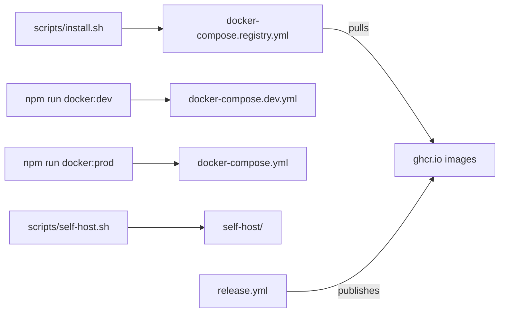

# `deployment/` — container images and compose stacks

Everything needed to run GraphDone in containers. There are two ways in: the
one-line installer, which pulls published images, and building from this checkout,
either with the compose files here or with the hardened [`self-host/`](self-host/README.md)
stack. Commands run from the repository root.

## Which one to use

| You want | Use |
| --- | --- |
| To try GraphDone on a machine with Docker | The installer in the [repository README](../README.md), which runs `docker-compose.registry.yml` |
| A production install on your own server or domain | [`self-host/`](self-host/README.md) via `./scripts/self-host.sh` |
| To develop with hot reload in containers | `npm run docker:dev` |

## What's here

| Path | What it is |
| --- | --- |
| [`docker-compose.registry.yml`](docker-compose.registry.yml) | Neo4j, Redis, API (:4128) and web (:3128) from the published `ghcr.io/graphdone/*:latest` images; used by `scripts/install.sh` |
| [`docker-compose.yml`](docker-compose.yml) | The same services built locally from `packages/server/Dockerfile` and `packages/web/Dockerfile`, web on :3128 (`npm run docker:prod`, `./start` Docker mode) |
| [`docker-compose.dev.yml`](docker-compose.dev.yml) | Development containers built from each package's `Dockerfile.dev`, web on :3127 (`npm run docker:dev`) |
| [`docker-compose.http.yml`](docker-compose.http.yml) | A plain-HTTP variant with every port exposed; no script uses it, only the version bump updates it |
| [`Dockerfile`](Dockerfile) | A single all-in-one runtime image (API serving the built web app, non-root); CI builds and checks it, but no release publishes it |
| [`neo4j.Dockerfile`](neo4j.Dockerfile) | The `graphdone-neo4j` image published with each release |
| [`self-host/`](self-host/README.md) | Source-based self-host stack (Caddy, nginx, API, Neo4j) |

The installer writes development TLS certificates to `deployment/certs/`, which is
not in the repository. The published web and API images are built from the
Dockerfiles in [`packages/web/`](../packages/web/) and [`packages/server/`](../packages/server/). Multipass VMs are scripts, not images: see [`scripts/vm/`](../scripts/vm/README.md).
How images are tested and published: [`.github/workflows/`](../.github/workflows/README.md).

Up: [repository root](../README.md)
