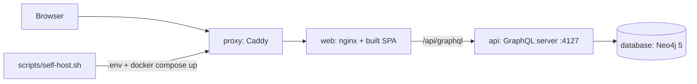

# `deployment/self-host/` — source-based self-host stack

A complete GraphDone you build from this checkout and run on your own machine or
server: Caddy in front (HTTP, or automatic HTTPS for a real domain), nginx serving
the web app and forwarding the API, the GraphQL server, and Neo4j.
`scripts/self-host.sh` writes the secrets and starts it.



## What's here

| File | What it is |
| --- | --- |
| [`compose.yml`](compose.yml) | The four services (`proxy`, `web`, `api`, `database`), their volumes and health checks |
| [`Dockerfile`](Dockerfile) | Multi-stage build from source: `build`, `production-deps`, `api` (Node) and `web` (nginx) targets |
| [`nginx.conf`](nginx.conf) | Serves the SPA (falling back to `index.html`) and proxies `/api/graphql`, `/api/`, `/auth`, `/health`, `/config` and `/mcp` to the `api` service |
| [`Caddyfile`](Caddyfile) | Front proxy: compression and reverse proxy to `web`; the address comes from `GRAPHDONE_ADDRESS` |

## How to use

```bash
./scripts/self-host.sh              # local: http://localhost:8080
./scripts/self-host.sh example.com  # a domain you own: HTTPS on 443
```

Up: [`deployment/`](../README.md)
