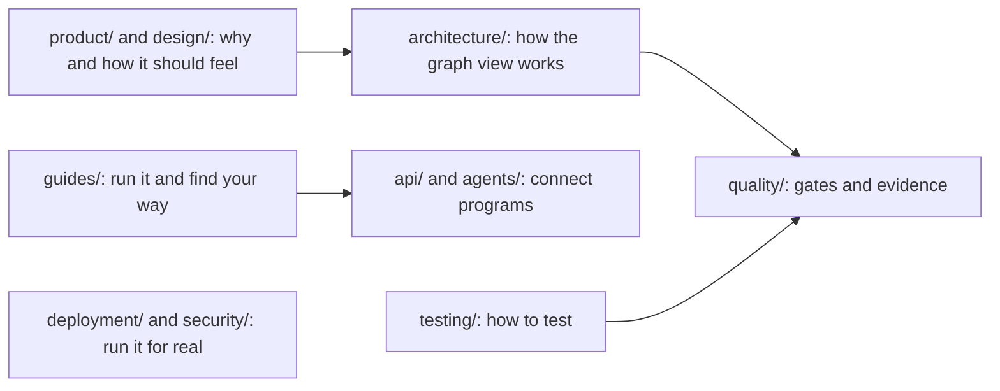

# GraphDone Documentation

Welcome to the GraphDone documentation! This directory contains comprehensive guides, API references, and deployment information for working with GraphDone.

## 🗂️ Folders

Every folder has its own README with a map of what is inside.



| Folder | What it holds |
| --- | --- |
| [`guides/`](guides/README.md) | Getting started, architecture overview, web UI structure, VM and hooks setup |
| [`features/`](features/README.md) | User-side walkthroughs: creating graphs, the admin pages |
| [`product/`](product/README.md) | The product decision: what Core is and how it relates to the hosted build |
| [`design/`](design/README.md) | Interaction rules and designs, each with its status |
| [`architecture/`](architecture/README.md) | Level of detail, layout and wire routing for large graphs |
| [`api/`](api/README.md) | GraphQL, MCP quickstart and the operations API |
| [`agents/`](agents/README.md) | Connecting your own AI agent, and its OpenAPI description |
| [`formats/`](formats/README.md) | Project export/import format, with an example file |
| [`testing/`](testing/README.md) | How to run the test suites and what each one proves |
| [`quality/`](quality/README.md) | Release gates, runbooks and dated validation records |
| [`deployment/`](deployment/README.md) | Deployment and self-hosting guides |
| [`security/`](security/README.md) | Authentication, OAuth and TLS |
| [`reviews/`](reviews/README.md) | Dated state-of-the-project reviews |
| [`img/`](img/README.md) | Shared artwork, such as the README banner |

Agent lessons and procedures live outside `docs/`, in [`.agents/`](../.agents/README.md).

## 📚 Documentation Structure

### [API Reference](./api/)
- GraphQL schema and resolvers
- REST endpoints
- WebSocket subscriptions
- Authentication and authorization

### 🌊 Living Graph Era (start here for current development)
- [User Stories — the backlog that drives development](./USER_STORIES.md) - **Every feature starts here; every story maps to tests**
- [Systems Reference](./SYSTEMS.md) - **What's shipped and where it lives** — every subsystem mapped to its code, tests, and story
- [Interaction Model — the friction-free contract](./design/interaction-model.md) - UX constitution: modes, exits, click budgets
- [Progressive Streaming design](./design/progressive-streaming.md) - ADAPT-4: scale to huge graphs on slow links
- [Dynamic graph LOD continuation](./architecture/dynamic-graph-lod.md) - Current evidence, semantic zoom, generic AI-authored systems, staged delivery and completion gates
- [First LOD slice: validation and screenshots](./quality/DYNAMIC_LOD_VALIDATION_2026-10-27.md) - Owned desktop/phone fixtures, tested revisions and remaining gates
- [CodeGraph LOD reuse](./architecture/codegraph-lod-reuse.md) - Working techniques, source references and regression contracts to share with GraphDone
- [Testing & Refinement Plan](./TESTING_AND_REFINEMENT_PLAN.md) - The never-done loop; current cycle's verification debt
- [AI Agents Quickstart](./api/AI_AGENTS.md) - 5-minute MCP/GraphQL setup for agent teammates

### [Developer Guides](./guides/)
- [Getting Started](./guides/getting-started.md) - Setup and first steps
- [Architecture Overview](./guides/architecture-overview.md) - System design and technical decisions
- [Web / UI Architecture](./guides/web-ui-architecture.md) - View system, graph canvas, mobile shell, node inspector
- [Testing Guide](../tests/README.md) - **E2E testing with robust authentication system**
- [SQLite Deployment Modes](./guides/sqlite-deployment-modes.md) - Local dev vs Docker authentication storage
- [User Flows](./guides/user-flows.md) - How teams actually use GraphDone
- [VM Setup (Multipass)](./guides/vm-setup.md) - Run GraphDone in a throwaway VM
- More: [`docs/testing/`](./testing/) (test architecture, PR + OAuth testing) · [`docs/security/`](./security/) (TLS, OAuth) · [`docs/deployment/`](./deployment/)

### 🤖 AI Agents Documentation
> **Start here**: [Simple AI Agent Reality Check](./simple-agent-reality.md) - **What we're actually building**

**Implementation Guides**:
- [Simple AI Agent Reality Check](./simple-agent-reality.md) - 🎯 **THE PLAN**: Smart chia pet with Ollama
- [AI Agents Technical Spec](./ai-agents-tech-spec.md) - 📚 Complete technical implementation (advanced)
- [Agent Planning Scenarios](./agent-planning-scenarios.md) - 🎪 Interactive planning examples (future)

### 🔒 Security & Production
> **CRITICAL FOR RELEASE**: [TLS Implementation Plan](./security/tls-implementation-plan.md) - **Required before production**

**Security Documentation**:
- [TLS Implementation Plan](./security/tls-implementation-plan.md) - 🚨 **MUST READ**: HTTPS, SSL certificates, secrets management
- [Production Security Checklist](./security/tls-implementation-plan.md#deployment-security-checklist) - Pre-launch security validation

### [Deployment](./deployment/)
- Docker setup
- Kubernetes manifests  
- Cloud provider guides
- Production considerations (see Security section above for TLS)

## 🚀 Quick Start

1. **Setup Development Environment**
   ```bash
   ./scripts/stack/setup.sh
   ```

2. **Start Development Servers**
   ```bash
   ./scripts/stack/run.sh
   ```

3. **Run Tests**
   ```bash
   ./scripts/stack/test.sh
   ```

4. **Build for Production**
   ```bash
   ./scripts/stack/build.sh --production
   ```

## 📖 Key Concepts

- **Graph-native collaboration** - Work flows through natural dependencies
- **Spherical priority model** - Ideas migrate from periphery to center
- **Democratic prioritization** - Community validation guides resource allocation
- **Human-AI coordination** - Smart chia pets that help with planning (see AI docs above)

## 🔗 Quick Links

- [Project Philosophy](./philosophy.md)
- [API Documentation](./api/graphql.md)
- [Deployment Guide](./deployment/README.md)

## 📞 Support

- [GitHub Issues](https://github.com/GraphDone/GraphDone-Core/issues)
- [Discussions](https://github.com/GraphDone/GraphDone-Core/discussions)

---

*For teams who think differently* 🌐
