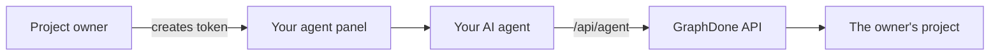

# `docs/agents/` — connecting your own agent

How a person connects an AI agent to a project they own, and the HTTP API that
agent then uses. Agents work with a project-scoped token; GraphDone does not run
models itself.

## What's here

| File | What it is |
| --- | --- |
| [`CONNECTION.md`](CONNECTION.md) | Human–agent collaboration: naming an agent, choosing access, creating a token and handing over the connection instructions |
| [`openapi.json`](openapi.json) | OpenAPI 3 description of the project-scoped agent collaboration API (`/api/agent`) |

See also [`../api/AI_AGENTS.md`](../api/AI_AGENTS.md) for the MCP and GraphQL routes.

Up: [`docs/`](../README.md)
