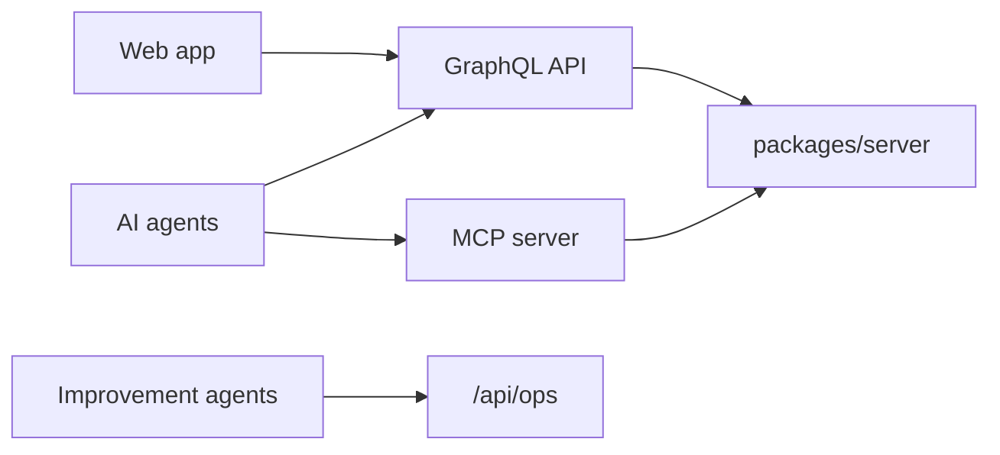

# `docs/api/` — API references

Reference pages for the interfaces programs use to talk to GraphDone: the GraphQL
API (what the web app uses), the agent quickstart, and the feedback/operations API.

## What's here

| File | What it is |
| --- | --- |
| [`graphql.md`](graphql.md) | GraphQL queries, mutations and subscriptions |
| [`AI_AGENTS.md`](AI_AGENTS.md) | Five-minute quickstart for agents using the MCP server or GraphQL |
| [`OPERATIONS.md`](OPERATIONS.md) | Feedback and improvement-agent API v1 (`/api/ops`), shared by Core and the hosted build |

Up: [`docs/`](../README.md)
