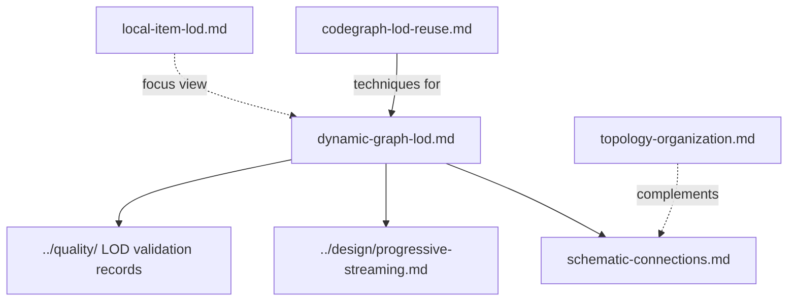

# `docs/architecture/` — keeping large graphs readable

How the graph view stays legible as projects grow to hundreds of items and dense
connections. These notes follow the owner's direction from October 2026: each one
records the problem seen, the technique chosen, the issues tracking it and the tests
that hold it in place. The code they describe lives mostly in
[`packages/web/src/lib/`](../../packages/web/src/lib/) (for example `semanticLOD.ts`)
and the graph canvas in `packages/web/src/components/`.

## Where to start

Read [`dynamic-graph-lod.md`](dynamic-graph-lod.md) first: it is the plan the
others hang off, and it says which parts are integrated on `dev` and which issues
are still open.

| File | What it covers |
| --- | --- |
| [`dynamic-graph-lod.md`](dynamic-graph-lod.md) | Semantic zoom (level of detail): overview groups, staged delivery, completion gates and current status |
| [`codegraph-lod-reuse.md`](codegraph-lod-reuse.md) | Mechanisms and regression contracts reused from the earlier CodeGraph project, instead of inventing a new zoom policy |
| [`schematic-connections.md`](schematic-connections.md) | Routing connections so the graph reads like a wiring schematic, with visual acceptance tests |
| [`topology-organization.md`](topology-organization.md) | Placing hubs at the centre of their neighbours so dense areas stop looking like a pile |
| [`local-item-lod.md`](local-item-lod.md) | Keeping the neighbourhood of a highly connected item readable when it is in focus |

Measured results and screenshots are in [`../quality/`](../quality/README.md)
(`DYNAMIC_LOD_VALIDATION_*`, `NESTED_LOD_VALIDATION_*`, `SCHEMATIC_ROUTING_VALIDATION_*`).

Up: [`docs/`](../README.md)
