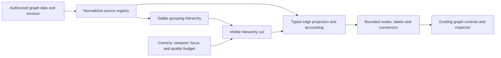

# Dynamic graph LOD: continuation through delivery

Reviewed 2026-10-27 UTC. Status: the first production-renderer overview slice is
implemented on the feature branch (section 8); the full dynamic LOD path remains
open. Source, GitHub and localhost observations below describe the reviewed base.
The stage IDs below are proposed work items, not existing GitHub issue numbers.

The owner's CodeGraph reuse direction is incorporated in the
[cross-project technique and source map](codegraph-lod-reuse.md). Use the working
mandala hierarchy/label logic and modern continuous Structure loading lifecycle
as implementation references. CodeGraph's standalone `lod.js` is not currently
wired into its viewers; do not mistake its self-test for production integration.

The outcome is a graph that remains understandable while moving between an
entire system, its subsystems, a neighborhood, and an individual item. Zooming
out must replace detail with readable meaning. Zooming back in must recover
the same items, relationships, selection, and spatial context.

The first delivery repairs the actual localhost use case. Completion also
requires generic AI-authored system graphs and a measured large-graph path;
the release-specific prototype alone cannot satisfy this feature.

## 1. Reviewed state

### Source and delivery inventory

| Surface | Observed state | Consequence |
| --- | --- | --- |
| Core remote `dev` | `ef495eff15ed7aac51e72dc7a1db1bb96d2b3695`, verified with `git ls-remote` | Base implementation work here, retaining the October save-recovery and performance-evidence fixes. |
| Core remote `main` | `775362eace0723c57b7ba3c7936645c9d0d36cb4` | Main is substantially older; do not start this work from its renderer. |
| Main promotion [PR #191](https://github.com/GraphDone/GraphDone-Core/pull/191) | OPEN; head `8a9c7512b5dedf4020d117887674d378de85667b`; `REVIEW_REQUIRED`, `BLOCKED` | A separate integration dependency for a main release, not a reason to stop LOD development on dev. Re-read state before integration. |
| Existing local semantic review | Branch `review/semantic-lod-20261024`, head `01f0c4df1ba82eaaca9769d366886c76b99f0e6b`; commits `fd72762` and `01f0c4d` add evidence, capture tooling, design and preview | Useful prior work, absent from remote dev. `git rev-list --left-right --count origin/dev...HEAD` there is `77 2`. Carry forward selected work onto current dev; do not build on the old runtime or overwrite new fixes. |
| Localhost application | `http://127.0.0.1:8540`, served asset `/assets/index-1788931697531.js` | The harness SHA is known; the deployed application's exact source SHA remains unproven. |
| Core rendering foundations | [PR #113](https://github.com/GraphDone/GraphDone-Core/pull/113), [PR #116](https://github.com/GraphDone/GraphDone-Core/pull/116), [PR #148](https://github.com/GraphDone/GraphDone-Core/pull/148), [PR #175](https://github.com/GraphDone/GraphDone-Core/pull/175) merged | Reuse edge fades/parallel offsets, layout, quality governor and strict measurement infrastructure. These are not semantic aggregation. |

The four local repos were clean at initial inspection. Existing worktrees were
preserved; no intentional graph edits were performed. The old preview service was inactive; this
review did not restart or deploy it. Fleet discovery failed before yielding
context, so no current fleet execution ownership is claimed.

### Current GitHub issues and how they affect this work

Checked open issues and PRs through the GitHub connector and existing GitHub CLI
on 2026-10-27. The CLI also checked private GraphDone-Cloud, GraphDone-Devops and
GraphDone-LandingPage: each returned zero open issues and zero open PRs. An
organization-wide open-issue search returned the same nine Core issues below.
There is no open semantic/dynamic LOD issue in that inventory. References such
as “#22” in old PR prose are not a current LOD tracking issue.

| Existing work | Relationship to this plan |
| --- | --- |
| [Core #181: unsent layout durability](https://github.com/GraphDone/GraphDone-Core/issues/181) | Coordinate saved-position behavior. Camera/aggregation must not create layout writes. Durable recovery of actual edits remains #181; do not represent local view-state persistence as fixing it. |
| [Core #182: hosted D1 acceptance](https://github.com/GraphDone/GraphDone-Core/issues/182) | Reuse its owned-browser, real readback, sync and account-isolation contract for hosted delivery. Core/Neo4j tests do not prove hosted behavior. |
| [Core #183](https://github.com/GraphDone/GraphDone-Core/issues/183), [#184](https://github.com/GraphDone/GraphDone-Core/issues/184), [#185](https://github.com/GraphDone/GraphDone-Core/issues/185), [#186](https://github.com/GraphDone/GraphDone-Core/issues/186) | Existing authentication/dependency work continues independently. Preserve its fixes and release disposition; it is not prerequisite work for pure LOD modules. |
| [Core #187: required checks](https://github.com/GraphDone/GraphDone-Core/issues/187) | Add LOD gates to existing CI/reporting and keep evidence failure-propagating. Branch-protection changes are separate work. |
| [Core #189: main promotion](https://github.com/GraphDone/GraphDone-Core/issues/189), [#190: release/deployment](https://github.com/GraphDone/GraphDone-Core/issues/190) | Source integration, registry publication and verified deployment are distinct steps. Do not close LOD delivery based only on a merge or a preview. |

### Fresh localhost observation

The existing read-only capture suite ran against **Graphlings Release** and
finished all 18 desktop/laptop/phone captures at `2026-10-27T14:56:23.996Z`.
The graph now has **301 nodes / 370 edges**, versus 299 / 370 in the October 24
review. Compare identity sets, not just the two-node net increase.

| Capture | Actual D3 scale | Readable individual titles (12px floor) | Painted edges |
| --- | ---: | ---: | ---: |
| 1600×1000 fit | 0.1090 | 0 | 0 |
| 1280×800 fit | 0.0844 | 0 | 0 |
| 390×844 fit | 0.0298 | 0 | 0 |
| 1600×1000 at 0.46 | 0.4600 | 0 | 135 |

At 0.46, measured title text was 5.76–8.39 screen pixels. Desktop and phone
screenshots were inspected: both fit views are unlabeled collections of cards,
without readable semantic replacements. Preserved geometry alone is insufficient.

**The sweep failed its read-only assertion.** Four GraphQL mutation attempts
were blocked, with no recorded page errors and unchanged node/edge identity sets.
A subsequent guarded diagnostic identified four `UpdateWorkItems` operations
whose update fields were `positionX` and `positionY`. It retained no credential,
payload values or session state; its process exited 143 after printing evidence,
so it is diagnostic output, not a passing test. The renderer's settle-persistence
path is a candidate cause, not an established request stack. The initial sweep
installs its guard after login; its evidence does not establish absence of writes
before that guard. The diagnostic guarded API traffic from before login, allowing
only queries and the login mutation. Do not remove the guard or call this a clean
read-only pass. Investigate on a disposable reproduction in LOD-0.

Private local evidence remains in the prior review worktree:
`test-artifacts/graph-lod-review/continuation-20261027/{index.html,report.json,*.png,graph-snapshot.json}`.
Browser: Chrome 151.0.7922.71; harness Node 20.20.2. No rendering-speed benchmark
was performed by this capture. Public fixtures must use synthetic content.

The existing review-guard unit suite passed **2/2**. Focused `edgeLOD`,
`parallelEdges`, `graphDataMerge` and `adaptiveQuality` suites passed **60/60**
in the prior review worktree. Those results establish the existing foundations;
they do not override the live sweep failure or validate future semantic LOD.
The four tested modules and four test files are byte-identical between that
branch and reviewed dev (`git diff --quiet` on the eight paths exited 0).
The refreshed snapshot contains 256 issues, 11 PRs, four milestones, 21 exit
criteria, eight goals and one gate; its edge types are 366 `DEPENDS_ON` and four
`BLOCKS`. Preserve type-specific denominators rather than calling every item an
issue or equating blocked status with a blocking relationship.

### Source findings that change the implementation order

1. `InteractiveGraphVisualization.tsx` uses a >150-node density threshold,
   simplification below 0.45 and dots below 0.2. CSS hides node text and then
   edges. Its camera, fit, culling, inspector and selection are reusable, but
   there is no semantic hierarchy/projection between data and rendering.
2. `edgeLOD.ts` controls direction visibility, opacity and parallel offsets.
   `shouldBundleEdges` is unit-tested but not imported by the main renderer.
   Coincident same-pair lines are not count-preserving group-edge bundles.
3. `GET_WORK_ITEMS` fetches descriptions and nested relationships for the full
   selected graph. The renderer supplies no paging options and polls nodes and
   edges every minute. `maxInitialNodes` and `labelLodZoom` are declared quality
   settings, not a working progressive-loading/semantic-detail implementation.
4. `mergeSimulationNodes` treats its input as a full snapshot: absent IDs become
   removals. `mergeSimulationEdges` drops edges with unloaded endpoints. The
   older [streaming design](../design/progressive-streaming.md) must be revised:
   feeding pages straight into these helpers would lose previously loaded work.
5. `nodes` initialization scans edges for each node. Zoom callbacks walk SVG
   selections and can measure title geometry. Profile these costs and replace
   repeated scans with indices before choosing a new rendering engine.
6. `metadata` is fetched and survives object spreading, but shared `WorkItem`
   typing lacks a normalized grouping contract. Graph/subgraph navigation is
   distinct from grouping within one graph; an overview group is not a new
   stored work item or permission boundary.
7. [Portable project/offline limits](../formats/PROJECT_TRANSFER.md) currently
   allow 300 nodes / 600 links. Larger AI-generated imports therefore require
   admission/import work even if Core's network-backed renderer can draw more.
   Hosted capacity, pagination and persistence need a separate Cloud contract;
   rendering optimization alone cannot establish larger hosted support.
8. The improved required performance suite measures four placed nodes and three
   edges. It establishes valid instrumentation, not 1k/10k scalability. The
   existing scale sweep is report-only; large-graph gates must become explicit.

## 2. Product contract and scope

| Detail | Visible representation | User can do |
| --- | --- | --- |
| System overview | Named subsystems/groups, scoped counts, status/exceptions, typed aggregated connections | Identify system areas, see important cross-area dependencies, choose a destination |
| Subsystem | Nested group boundaries and anchors; smaller groups remain summarized | Expand one area while retaining neighboring context; trace cross-area relationships |
| Neighborhood | Compact named items, selected one/two-hop relationships, offscreen destination summaries | Search, follow upstream/downstream links, select an exact item |
| Item detail | Existing card/inspector and full canonical relationship list | Read the exact title, description and provenance; perform existing authorized edits |

Expose `Auto / Overview / Groups / Items` detail controls and a grouping selector.
Wheel/pinch remain spatial zoom; never silently change the app to a table.
Expansion overrides are user intent, while Auto adjusts the visible hierarchy
cut using projected size, local density, viewport obstacles and device budget.

Selected items, keyboard focus, search results and inspected relationships stay
reachable at every scale. A collapsed ancestor carries the selection marker;
search expands/frames the path. Back/Escape restores the prior camera and cut.
Full source titles and IDs remain inspectable. Short labels are separate display
aliases, never destructive edits to imported names.

The release graph supplies an initial metadata adapter. Generic graphs must
also work. Within the active lens, precedence is: authored grouping override,
explicit subsystem/group path, declared containment edges, configured metadata/
tag grouping, then deterministic suggested topology groups. Normalize native
`IS_PART_OF` (child→parent) and `CONTAINS` (parent→child), including Grow's existing
`IS_PART_OF` output. Conflicting paths or multiple parents require a visible
diagnostic and a documented primary-parent choice/override; retain secondary
memberships and every original relationship. Suggestions
are labeled and stable until explicit rebuild or relevant data revision. A giant
“Unassigned” group alone is not completion for unannotated system graphs. Never
infer ownership or execution order from geometry or reinterpret `DEPENDS_ON` as
containment. Preserve `BLOCKS`, opposing directions, cycles and self-loops.

The completion target proposed for this path is **10,000 source nodes / 50,000
edges on a documented desktop profile**, with a 1,000 / 5,000 mobile gate and
bounded access to the larger graph through summaries. First useful delivery is
the real 301-node graph plus a synthetic equivalent, then a strict 1k gate.
100k+ is exploratory, not an implied unlimited-capacity promise. These are proposed
acceptance targets, not observed capabilities; ratify the hardware/budgets in
LOD-0 and retain failed measurements instead of quietly reducing the target.

Release/milestone matrices, review queues, AI-written summaries and historical
diffs are useful follow-ups. They are not on the critical path for dynamic LOD.
Basic grouping, fallback for unannotated graphs, truthful relationships, navigation,
large-data access and persistence compatibility are on that path.

## 3. Architecture decisions



- **One source registry.** Retain canonical node/edge identity, metadata, loaded
  state and revision outside D3 objects. Full snapshot replacement, page append,
  update and deletion/tombstone are distinct operations. Unloaded is not deleted;
  hidden/filtered is not unloaded. Resolve late endpoints without losing edges.
- **Stable grouping.** A pure `graphGrouping` module produces scoped group keys,
  parent/child membership, display names and diagnostics. Each source node has
  one primary owner per active lens; overlapping tags are secondary facets.
  Detect missing parents, cycles, duplicate keys and depth overflow. Preserve
  affected nodes in visible diagnostic/unassigned groups. Rebuild on relevant
  data/lens changes, not wheel events.
- **Count-preserving projection.** Pure `graphProjection` maps each authorized,
  in-scope node to a visible representative. Aggregate edges by source
  representative, target representative, type and direction. Keep underlying
  IDs addressable; internal edges become inspectable counts. Use an exclusive
  accounting ledger: rendered individual, aggregated, internal, explicitly
  filtered, or pending endpoint. Viewport culling is a presentation attribute,
  not another source-edge category. No silent loss or double counting.
- **One LOD policy.** `semanticLOD` consumes projected dimensions/density and
  existing adaptive-quality signals. Quality may lower effect/primitive budgets,
  but it must not erase the last readable group identity. Replace conflicting
  thresholds gradually; retain edgeLOD helpers where useful at item detail.
- **Readable labels.** A screen-space label layer with deterministic priority
  and collision handling; group titles ≥14px and item names ≥12px. Budget names
  by available space (initially 24–40 desktop, 6–10 phone). Reserve focus/search
  and blocker labels; expose overflow explicitly. Obstacles include headers,
  floating controls, inspector and minimap. Verify hit-testing as well as bounds.
- **Stable motion.** Start with 15–20% hysteresis and 150–250ms crossfades, tuned
  against real wheel/pinch input. Freeze expensive membership computation during
  a gesture. One representation owns input during transitions; reduced motion
  uses immediate stable swaps. Keep the zoom anchor stable across expansion.
- **Separate coordinates and writes.** Summary anchors and temporary expanded
  layout are view coordinates. Preserve saved item positions and manual pins.
  Zoom, fit, collapse, filters and view restoration enqueue no node-position
  mutation. Drag/explicit layout commands retain the existing save queue and
  error handling. Synthetic summary IDs can never reach CRUD/undo mutations.
- **Scoped view state.** Versioned camera/lens/expansion/selection state keyed
  by owner + graph, with pruning on deletion and permission loss. Use local view
  persistence first; portable saved views require explicit format support.
  It does not replace the pending-edit durability work in #181.
- **Bound work, not just opacity.** Render only the chosen projection, with
  overscan. Cache indices and aggregates; coalesce camera changes once per
  animation frame. Run costly grouping/layout in a cancellable worker if needed;
  reject stale results after graph/account/lens changes. Avoid force reheats on
  zoom. Retain SVG for the first useful slice. Decide Canvas/WebGL from profiles
  after projection; preserve accessible DOM controls and hit-testing if changed.

## 4. Ordered delivery backlog

Every stage is a reviewable PR or small PR series. Tests below extend existing
Vitest/Playwright/unified-report infrastructure. Keep stages open until their
acceptance evidence exists; the names do not imply an issue has been created.

| Stage / proposed title | Deliverable and boundary | Depends on | Exit evidence |
| --- | --- | --- | --- |
| **LOD-0 — Establish the current semantic-zoom baseline** | Port the useful October capture helpers onto current dev without old runtime code or private captures. Add a synthetic release-shaped fixture and a generic subsystem fixture. Add complete read-only request guarding and safe operation diagnostics; reproduce the position-write attempt on owned data. Pin hardware, target graph identity and budgets. | None | Missing-data, attempted-write and missing-metric negative controls fail. Desktop/phone baseline retained. Diagnose or explicitly isolate pre-existing layout autosave before declaring a clean live review. |
| **LOD-1 — Normalize grouping and conserve graph identity** | Typed metadata adapter, stable hierarchy and projection modules; graph revision and exact/partial count semantics. Support release lanes and generic nested group paths. Build directed/type-aware aggregate edges from the outset. | LOD-0 fixture contracts | Unit/property tests conserve nodes/edges, survive bad metadata/cycles, preserve antiparallel and mixed-type edges, and round-trip expand/collapse. |
| **LOD-2 — Ship a readable overview in the real renderer** | Render named summary primitives and basic typed connectors; scoped counts, blocker indicators, group click/keyboard focus, breadcrumb and back. Retain the existing detail renderer and inspector. Feature flag permits comparison/rollback. | LOD-1 | Real localhost and synthetic release-shaped overview have readable groups and all explicit blocking relationships discoverable at fit scale; summary drill-down reaches exact items; no saved-position writes during navigation. |
| **LOD-3 — Make detail continuous and locally adaptive** | Screen-space labels, compact items, local density/quality budgets, hysteresis, transition ownership, selection/search retention, inspector-aware fit, touch and keyboard behavior. | LOD-2 | Repeated 0.44↔0.46 and 0.19↔0.21 crossings produce no anonymous interval, focus loss or uncontrolled card explosion. Dense and sparse regions can use different representations. All label/hit-target floors pass. |
| **LOD-4 — Complete relationship exploration** | Exact bundle drill-down, internal-edge inspection, focused 1–2 hops, upstream/downstream convention, named offscreen ports, complete accessible relation list and filtering denominators. | LOD-2; integrate with LOD-3 | Every source edge is accounted for; selected paths remain traceable through collapse; exact IDs/types/directions return from bundle expansion; cycles/self-loops/100+ degree hubs are navigable. |
| **LOD-5 — Support AI-authored systems and unknown schemas** | Document an optional versioned grouping/display metadata contract and an AI-authoring example. Preserve canonical titles/provenance. Validate import/export/MCP/API round trips. Add deterministic suggested grouping for graphs without metadata; rename/pin/split/merge overrides survive updates. | LOD-1; UI uses LOD-3/4 | A nested software system and an unannotated topology graph both support overview→detail→back. Imported IDs/group references remap correctly. Malformed AI payloads retain recoverable data and explain errors. No inference/remote summarization runs on zoom; bounded, coalesced and cancellable graph-data requests may serve a newly visible region. |
| **LOD-6 — Enforce 1k scale and bounded rendering** | Source-registry caching, adjacency/spatial indices, projected DOM budget, metrics for projection/labels/frame latency, cancellable workers where profiling requires. Remove repeated full-graph scans from gesture work. | LOD-3/4; generic fixtures from LOD-5 | Required 1k/5k-edge desktop and mobile journeys pass with exact source counts and no sentinel metrics, retries or required skips. Publish CPU/layout/paint traces and before/after measurements. |
| **LOD-7 — Load and navigate 10k graphs without full hydration** | Replace the obsolete streaming assumptions with an authorized overview/neighborhood/page contract; bounded first paint, summary-first loading, cancellable requests, stable cursors/revision, pending endpoints and server-side search. Integrate import/storage admission limits. | LOD-1 source semantics; full UI on LOD-6 | End-to-end 10k/50k graph loads a truthful overview, searches an unloaded item, expands its region and follows edges without downloading all descriptions first. Missing/delayed/duplicate/stale pages cannot erase data or claim completeness. |
| **LOD-8 — Prove cross-backend compatibility** | Cloud-owned adapter and capacity policy; align authorized summary/page/search contracts, Core submodule pin, offline/import behavior, metadata round trips and bounded persistence. Preserve conservative public guest admission separately from larger supported accounts/operators. | LOD-5/7; #182 acceptance infrastructure | Owned Core and hosted/staging browser journeys return equivalent memberships, relationships and selection. Real persistence/account-isolation readback; visible limit errors and recovery. Exact frontend/API/schema versions recorded. |
| **LOD-9 — Release and close the feature** | Reconcile current base, complete review/gates, document controls/limits, rollout flag, verify installed artifacts and rollback. Move the canonical design/story status with the implementation. | LOD-0…8; applicable #189/#190 path | All definition-of-done rows below satisfied on the delivered build; remaining enhancements separated. Merge/preview alone cannot close this stage. |

The shortest first-useful path is **LOD-0 → LOD-1 → LOD-2**. The next milestone is
**LOD-3 + LOD-4 + LOD-5 → LOD-6**. API contract design for LOD-7 can proceed once
LOD-1 establishes identity/count semantics; the completion gate remains after
the integrated UI. Cloud planning can start early without changing deployment.
Avoid a wholesale rewrite of the 6k-line renderer as a prerequisite: introduce
the projection boundary, then extract the layers touched by each slice.

### The first implementation PR

Start from current dev, rechecking upstream and active ownership. Bring the
read-only review helper and its tests forward with source/build provenance;
keep the static walkthrough as a reference artifact. Add sanitized fixtures,
normalization/grouping types and conservation tests. Extend shared WorkItem
typing rather than hiding metadata parsing in SVG callbacks. Keep runtime
behavior behind the existing renderer boundary until LOD-1 invariants pass.

The first renderer PR then consumes that projection for overview + basic
relationships + drill-down. Do not spend this first slice on the release matrix,
automatic prose summaries, a WebGL migration, or a fresh test platform.

## 5. Large-data and AI authoring contracts

The June streaming proposal's offset/dedup sketch is insufficient for mutable
large graphs and exact totals. Specify an authorized, revision-aware API in
LOD-7 (names such as `graphOverview`, `graphNeighborhood`, `graphPage` are proposed):

1. Overview returns group identity/hierarchy, exact authorized counts, bounded
   typed aggregate connections, freshness/revision and completeness status.
   It must not fetch every long description merely to compute the overview.
2. Neighborhood/member pages return stable IDs, cursor/tie-breaker and revision;
   cancel obsolete requests on graph/lens/account change. A stale page cannot
   replace a newer edit or expand a graph the user has left. Concurrent edits
   require revision restart/reconciliation, not a false “all loaded” badge.
3. Server-side search returns exact matches plus their grouping path and a way
   to fetch the selected item; client-only search cannot cover unloaded data.
4. Source storage explicitly models pending endpoint edges and deletions. Reuse
   D3 identity merge on the reconciled loaded set, never on a single page.
5. Counts distinguish total authorized, filter-matched, loaded and visible.
   Partial counts are labeled. Do not derive a total from the current page or
   leak inaccessible node existence through summary counts or edge endpoints.
6. Authorization filters precede aggregation. Cache keys include access scope,
   graph revision and grouping/filter schema. Revoked access clears the affected
   registry, view state and pending requests. Test cross-account negative cases.
7. Query cost, response bytes, cache size, concurrency and import size are bounded.
   Respect Save-Data/low tiers; expansion works on demand. Error/offline/loading
   states retain existing context and do not become “empty graph.”

For AI-produced graphs, begin with a documented optional namespace inside the
existing metadata envelope: schema version, stable semantic group path/key,
display alias and provenance. Final field names are part of LOD-1/5 review.
Unknown metadata is preserved. Primary membership is deterministic; multiple
lenses do not multiply counts. Group references must use portable semantic keys
or be explicitly remapped with fresh node IDs on import. The current opaque
metadata string does not automatically remap embedded node references.

Provide one validated JSON example and one API/MCP creation example for a
system→service→component hierarchy with cross-service typed edges, cycles,
unassigned items and long names. Confirm the actual importer and server support
those contracts; merely documenting a payload is not acceptance. Any schema
change must retain existing version-1 import/export compatibility or offer an
explicit versioned migration. Large import limits must be reconciled across UI,
offline store, portable validation and backend admission.

Core owns portable semantics, renderer, agent authoring contract and tests.
Cloud owns hosted storage/admission, adapter parity and deployment evidence.
Devops changes are needed only if packaging/observability requirements emerge;
LandingPage changes follow demonstrated capability and documented limits.

## 6. Validation and performance gates

Extend `edgeLOD`, `parallelEdges`, `graphDataMerge`, `adaptiveQuality`, adjacency
and projection unit suites. Add a dedicated semantic-LOD browser suite within
the current graph/quality projects and report manifest, using existing seed,
auth, cleanup, screenshot and diagnostic helpers. Port the live review as opt-in
read-only evidence; never run mutating scale fixtures against the user's graph.

| Layer | Required cases |
| --- | --- |
| Pure invariants | Unique node coverage; exclusive edge accounting; stable IDs/order under reordered input; nested/cyclic/missing membership; self/parallel/opposite edges; internal counts; filter denominators; expansion round trip; partial pages and deletions |
| Small regression | 0/1/12/50/150/151 nodes; existing create/edit/delete/grow/drag/undo, subgraph navigation, saved positions and small-graph readability |
| Real shape | Sanitized prior 299-node shape and refreshed 301-node shape; all source entities and blocking relationships preserved; long imported titles, pinned lanes, hubs and supporting entity types |
| Generic systems | Nested explicit subsystems; containment-only IS_PART_OF/CONTAINS hierarchy; conflicting metadata/containment and multiple parents; metadata-free communities; disconnected islands; dense/sparse areas together; multilingual/long labels; high-degree hub; cyclic typed dependencies |
| Scale | 500/1k/2k/10k nodes with recorded edge counts/density; 1k/5k and 10k/50k strict targets; placed and unplaced layouts measured separately |
| Interaction | Fit→expand→select→collapse→return; search in collapsed/unloaded group; repeated threshold crossing; pan to offscreen port; resize/inspector; wheel/pinch/tap/keyboard; reduced motion; browser zoom and device-pixel ratio |
| Live updates | Added/removed/moved items, metadata changes, delayed acknowledgements, deleted selection, stale worker/page response, account switch/revocation, graph switch during expansion |
| Persistence | Zero node writes for navigation; real edits still use save recovery; owner-scoped view restoration; import/export identity mapping; no synthetic summaries persisted as nodes |

Proposed acceptance budgets, to freeze in LOD-0 on named hardware/browser:

- Readable summary titles ≥14 screen pixels; item labels ≥12; ordinary touch
  targets ≥44px. No overlap/occlusion of required labels or pointer interception.
  Test actual visible text and ordinary clicks, not DOM existence or forced clicks.
- At 1k/5k, p95 input-to-next-frame <50ms; aim for ≤16.7ms steady desktop pan
  frames and ≤33.3ms on the mobile profile. No >100ms main-thread task caused by
  an LOD transition. Report median/p95/worst, not only average FPS.
- At 10k/50k on the desktop profile, p95 input-to-next-frame <50ms after overview
  availability, using bounded projection; do not relax readability to meet time.
  Record overview load, detail load, API time, transfer bytes, DOM primitives,
  projection/label time, heap and retained cache separately.
- Preserve the ADAPT-4 target of useful first paint <2s for 1k on explicitly
  configured simulated 3G; define latency/bandwidth/cache settings in the fixture.
  For 10k, proposed useful overview <3s on the documented normal-network profile.
  “Useful” requires readable summaries and counts, not a spinner or first dot.
- Repeated full zoom/expand/collapse/graph-switch cycles must plateau in retained
  DOM/cache/heap after cleanup. Set concrete memory caps from the LOD-0 profiles;
  no numeric heap limit is claimed as measured by this review.
- Existing strict smoke, mobile, layout/durability, unit/harness and required CI
  gates stay enabled. Required LOD cases have zero skips/retries/flaky passes;
  missing or stale metrics fail. Keep failure evidence and fixture cleanup results.

Retain exact source/lockfile, served build identity, backend/schema/graph revision,
browser/hardware/viewport/DPR, fixture seed and edge density, flags, network/CPU
settings and projection counts with results. FPS from this workstation does not
establish phone performance. The current host is Ryzen 9 3900X / 24 logical CPUs;
headed GPU rendering and headless/software rendering must be labeled separately.

Run task-based human checks at the 301-node and generic-system milestones:
identify a subsystem within 10 seconds, locate a blocker and inspect its source
within 30 seconds, follow a cross-subsystem dependency, and return without losing
place. Record correct/incorrect answers and navigation failures; screenshots
and geometry checks alone cannot establish comprehension.

## 7. Definition of done and rollout

- [ ] Real localhost and generic AI-authored graphs remain named and navigable at
  every detail band; automatic zoom and manual overrides agree.
- [ ] Selection/search/keyboard/touch and typed relationships survive every
  collapse/expand/filter boundary; exact source data remains inspectable.
- [ ] All node/edge accounting, metadata/import and partial-loading invariants pass.
- [ ] The 1k/mobile and 10k/desktop targets pass on documented profiles, including
  first useful load and bounded rendering, rather than only a cached static demo.
- [ ] Navigation changes no saved positions; actual edits retain existing recovery
  guarantees. LOD does not silently weaken #181 or import/offline compatibility.
- [ ] Hosted supported limits and behavior are explicit and tested with real
  account-isolated persistence. Any hosted large-capacity gap remains open,
  rather than being hidden by a Core-only success.
- [ ] Source review and current required gates pass; released/installed frontend
  and backend versions are verified. Documentation, stories and regression index
  are updated with actual evidence and remaining limits.
- [ ] Rollback is proven: disable the feature or restore the prior tested build
  without rewriting source graph data or destroying saved user layouts.

Roll out behind a developer/test flag, validate owned fixtures, then conduct a
guarded review of the real localhost graph. Enable for supported large graphs
after acceptance; retain the manual detail control and accessible relation list.
Ship the exact reviewed Core revision through each installation's existing
release path. Recheck #191/#189/#190 rather than assuming their October status.

The first implementation below advances LOD-1/2 on current dev. The feature
remains open until the checklist above has evidence on the delivered application.

CodeGraph-informed refinement: LOD-0 includes intermediate-zoom coverage, label
self-resolution and stable-page/camera tests. LOD-1 adopts parent fallback and
explicit page accumulation/epochs from the outset. LOD-3 applies geometry/transition ideas in GraphDone's own implementation; LOD-7
adapts generation-bound, coalesced loading. Domain-specific edge projection and
GraphDone edit/persistence behavior remain explicit responsibilities.

Owner clarification (2026-10-27): reuse ideas in both directions with CodeGraph;
keep implementations independent. No shared libraries or common package.

## 8. First production-renderer slice (2026-10-27)

See the [validation record and screenshots](../quality/DYNAMIC_LOD_VALIDATION_2026-10-27.md)
for exact revisions, passing checks, retained failures and remaining integration gates.

`packages/web/src/lib/semanticLOD.ts` now projects loaded source items into
top-level groups. Precedence is explicit `metadata.lod.groupPath` (or
`metadata.groupPath`), native containment, release `lane`, `kind`, then item type.
Metadata may be a JSON string or an object. For example:

```json
{"lod":{"groupPath":["Payments","Settlement workers"]}}
```

This initial cut displays **Payments**; nested spatial expansion is still pending.
Containment directions are normalized, cycles terminate deterministically, and
multiple-parent/conflicting-path diagnostics remain visible in the group list.
Every loaded relationship is accounted for as an internal link, a typed directed
bundle, or a pending-endpoint edge. Canonical items/edges are retained unchanged.

`SemanticGraphOverview` is integrated into `InteractiveGraphVisualization`, not a
standalone preview. Graphs with at least 40 loaded items offer Auto, Overview and
Items. Auto retains summaries through a hysteresis band. Group labels use fixed
14px screen-space text, avoid current graph controls, and keep their slots during
camera gestures. Leaders connect labels to source centroids; arrows show bundled
directions. The group browser supplies exact typed counts and full member titles.
Groups that cannot fit on a phone remain available through the complete group
list. Inspecting a member selects the original item in the existing inspector;
Back restores the entry camera and detail mode.

The summary layer is a React-owned SVG `foreignObject` inside the existing D3
camera surface. Native wheel, mouse and touch gestures use the existing zoom
behavior. D3 owns only its sibling graph layers and direct-child definitions.
Source layers are removed from painting/hit testing while Overview is active;
projected coordinates never enter the source simulation or position-save queue.

This is a useful **overview and navigation slice**, not completion of LOD-2/3.
It still loads and constructs the full source SVG. The next implementation work
is a nested spatial cut with stable group anchors, continuous readable transitions,
selected/search-path expansion, per-region density budgets, and typed relationship
inspection. Type fallback is explicit, not claimed topology clustering. Streaming,
worker cancellation, import limits, Cloud parity and the 1k/10k capacity gates
remain open. The existing autosave behavior for newly laid-out or overlapping
source items is outside this slice; zero-write navigation is tested on pinned,
non-overlapping owned fixtures rather than asserted for every legacy graph.
