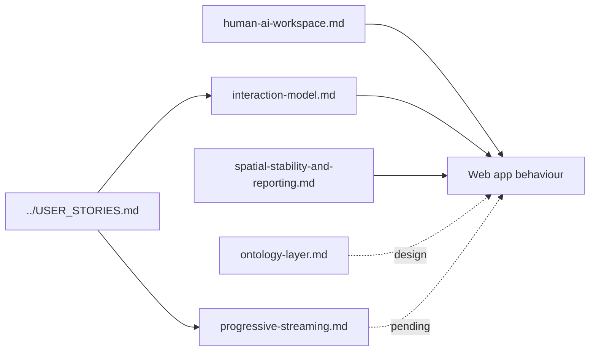

# `docs/design/` — product and interaction design

The design decisions behind how GraphDone feels to use. Each document opens with a
status line and date: some are accepted rules the app must follow, others are
designs whose implementation is still pending. Read the status before treating a
document as a description of the current app.

## What's here

| File | Status | What it covers |
| --- | --- | --- |
| [`interaction-model.md`](interaction-model.md) | Accepted 2026-06-11 | The UX rules: every workflow is a state machine with a visible state and an exit, and every click must earn its place |
| [`human-ai-workspace.md`](human-ai-workspace.md) | Direction, 2026-09-07 | A friendly place for people to work and follow AI-driven development; agents act through authenticated interfaces |
| [`spatial-stability-and-reporting.md`](spatial-stability-and-reporting.md) | Findings and plan, 2026-06-13 | Items stay where people put them, physics that can be measured and tuned, and one test report with screenshots |
| [`progressive-streaming.md`](progressive-streaming.md) | Accepted 2026-06-11, implementation pending | Loading very large graphs gradually on slow links (story ADAPT-4) |
| [`ontology-layer.md`](ontology-layer.md) | Design v1, 2026-06-11 | Task management as one ontology among many (requirements, risk, ...) on the same graph |

For what the product is for, see the decision record in
[`../product/`](../product/README.md); for the rendering techniques, see
[`../architecture/`](../architecture/README.md).

Up: [`docs/`](../README.md)
