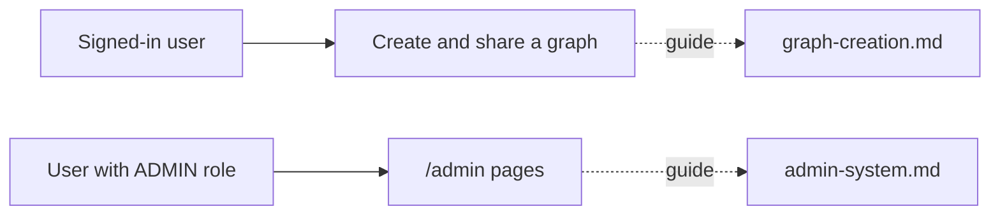

# `docs/features/` — feature walkthroughs

Longer, user-side guides to individual features: where to find them in the app,
what each screen does, and who is allowed to use it.

## What's here

| File | What it covers |
| --- | --- |
| [`graph-creation.md`](graph-creation.md) | Creating a graph and taking it from first idea to shared work with a team |
| [`admin-system.md`](admin-system.md) | The `/admin` pages for users, security and system operations; needs the `ADMIN` role |

The design rules these features follow are in [`../design/`](../design/README.md).

Up: [`docs/`](../README.md)
