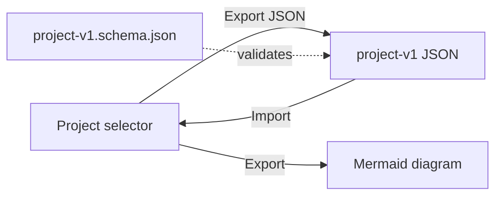

# `docs/formats/` — file formats

Formats GraphDone reads and writes, with examples. The JSON schema for project
files also ships with the web app at `packages/web/public/schemas/`.

## What's here

| File | What it is |
| --- | --- |
| [`PROJECT_TRANSFER.md`](PROJECT_TRANSFER.md) | Exporting and importing a project as JSON, and exporting it as Mermaid |
| [`project-v1.example.json`](project-v1.example.json) | A complete example project file in the v1 format |

Up: [`docs/`](../README.md)
