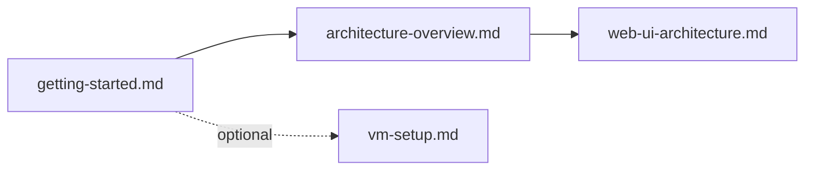

# `docs/guides/` — developer and user guides

How-to guides for running GraphDone, finding your way around the code and using
the app. If you are new, read them in this order:

## What's here

| File | What it covers |
| --- | --- |
| [`getting-started.md`](getting-started.md) | Installing, starting the development stack and first steps |
| [`architecture-overview.md`](architecture-overview.md) | The packages, how they talk to each other, and the main technical decisions |
| [`web-ui-architecture.md`](web-ui-architecture.md) | How `packages/web` is structured: views, graph canvas, mobile shell, item inspector |
| [`user-flows.md`](user-flows.md) | How people first meet GraphDone and work with it day to day |
| [`sqlite-deployment-modes.md`](sqlite-deployment-modes.md) | Where the SQLite authentication database lives in local development versus Docker |
| [`vm-setup.md`](vm-setup.md) | Running GraphDone in a throwaway Multipass VM (scripts in [`scripts/vm/`](../../scripts/vm/README.md)) |
| [`ai-agents-integration.md`](ai-agents-integration.md) | Early ideas for playful AI companions. Superseded by the [product decision](../product/CORE_HOSTED_STRATEGY.md); for connecting an agent today, see [`../agents/`](../agents/README.md) |

Testing has its own guide: [`../testing/`](../testing/README.md) and
[`tests/`](../../tests/README.md).

Up: [`docs/`](../README.md)
