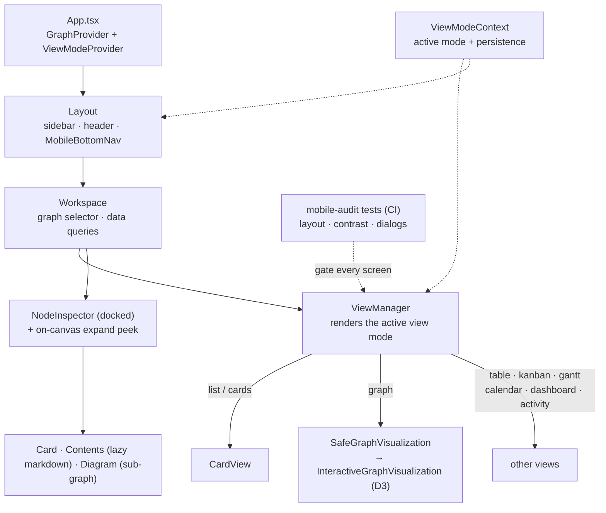

# Web / UI Architecture

How the client (`packages/web`, React 18 + Vite + Tailwind + D3) is structured.
This is the companion to [architecture-overview.md](./architecture-overview.md),
which covers the server / graph engine / data layer.

## Pieces

- **App shell** — `App.tsx` wraps the tree in `GraphProvider` (current graph +
  drill-in/ascend) and **`ViewModeContext`** (`contexts/ViewModeContext.tsx`), the
  single source of truth for the active view, persisted to `localStorage`. `Layout`
  draws the chrome.
- **View system** — `ViewManager` renders one of 8 modes: `cards`, `graph`,
  `table`, `kanban`, `gantt`, `calendar`, `dashboard`, `activity`. Phones default to
  **`cards`** (a readable list); desktop defaults to `graph`.
- **Graph** — `SafeGraphVisualization` error-boundary-wraps
  `InteractiveGraphVisualization`, the D3 force-directed canvas (one-shot physics,
  viewport culling, LOD by zoom — see `LOD_THRESHOLDS`).
- **Node inspector** — a docked `NodeInspector` plus an on-canvas **expand-in-place**
  peek, each with a **Card / Contents / Diagram** toggle readable at any zoom
  (`NodeContentRenderer` lazy-loads markdown/Prism; `NodeSubgraphPreview` draws a
  capped static sub-graph). In-canvas card titles have a zoom-decoupled
  **legibility floor**.

## Responsive tiers (boundary: Tailwind `md`, 768px)

- **Phone (`<md`, or a phone held sideways)** — `MobileBottomNav` (List / Graph / More) is the primary nav;
  slim chrome; the sidebar/desktop header are hidden. On the graph:
  - Controls are one column in the bottom-right corner (`PhoneGraphControls`):
    View, Recentre, and Lock ("Move cards", off by default so a drag pans).
    View holds which connections to draw and Organize, and appears only when
    the graph has connections. A large graph's group overview puts the column
    top-right instead, where its own panels leave room.
  - A tap selects a card and shows a peek sheet (title, status, priority,
    contents, Edit); editing is one more tap.
  - The graph opens at a zoom where every card shows its title and a status
    stripe (`PHONE_READABLE_SCALE`), centred on the highest-priority item;
    the rest is a pan away.
  - Grow mode's hint sits in the bottom bar with Cancel.
- **Tablet & desktop (`≥md`)** — sidebar rail + full top view-strip + all filters.

## UI conventions

Patterns the existing code follows; new UI should match them.

- **Overlays** (dialogs, menus, popovers) render with
  `createPortal(element, document.body)` so no parent's stacking context clips
  them, and register with `useDialog(isOpen, onClose)` from
  `src/hooks/useDialogManager.ts`. Opening an exclusive dialog closes the others
  (pass `{ exclusive: false }` for a dialog inside a dialog), and Escape closes
  the top one. The manager also offers `closeAllDialogs()`, but nothing in the
  app calls it yet, so click-outside behaviour is up to each component.
- **Top bar**: `pages/Workspace.tsx` uses three sections: left for the graph
  selector and search, centre for view-mode buttons, right for status and
  secondary actions, on a translucent `backdrop-blur-sm` bar. New pages with a
  top bar follow the same layout.
- **Contextual editors over modals**: edit next to the thing being edited (as
  the relationship-type picker on the graph does) rather than in a full-screen
  modal, and update local state and GraphQL together so the change shows at once.
- **Colours by type and status** come from the static Tailwind class maps in
  `src/constants/workItemConstants.tsx` (`getTypeGradientBackground`,
  `getStatusGradientBackground`). Tailwind only ships classes it can see, so
  never build class names by string interpolation.
- **Animation** uses `transform` and `opacity`, not layout properties; motion is
  removed for `prefers-reduced-motion`.
- **D3 in React**: stop force simulations and remove listeners in the
  `useEffect` cleanup, or they keep running after the view unmounts.

## Quality gate

`tests/e2e/mobile-audit.spec.ts` + `mobile-dialogs.spec.ts` run the
`tests/lib/mobileAudit.ts` auditors (sideways-scroll, squeezed labels,
low-contrast/invisible text, modals clipped under the nav) across **every** screen
at phone width, in CI right after the smoke gate.

**Massive local report** — `npm run report:matrix` (then `npm run report:matrix:open`)
runs `tests/e2e/feature-matrix.spec.ts`: every view (8) + page (6) + signin + key
features (inspector / expand peek / create modal) at **6 resolutions** (360→1920),
each cell screenshotted **and** layout/contrast-audited. `tests/generate-matrix-report.mjs`
stitches the screenshots into one self-contained gallery
(`test-artifacts/matrix/index.html`, feature × resolution grid). Heavy; local-only,
not in the smoke gate.
