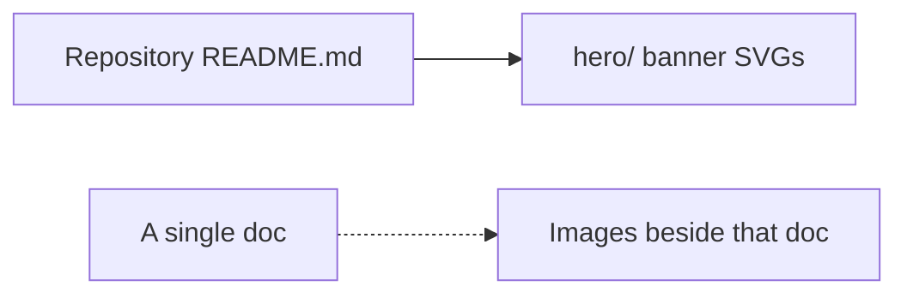

# `docs/img/` — shared documentation artwork

Images used by more than one page, or by the repository front page. Images that
belong to one document live beside it instead (for example the evidence
screenshots in [`../quality/images/`](../quality/images/README.md)), so they move
and get deleted together with the text that explains them.

## What's here

| Path | What it is |
| --- | --- |
| [`hero/`](hero/README.md) | The animated banner at the top of the repository README, in light and dark versions |

The older UI screenshot `graphdone_ui.png` is still in [`docs/`](../README.md) itself,
because the repository README links to it there.

Up: [`docs/`](../README.md)
