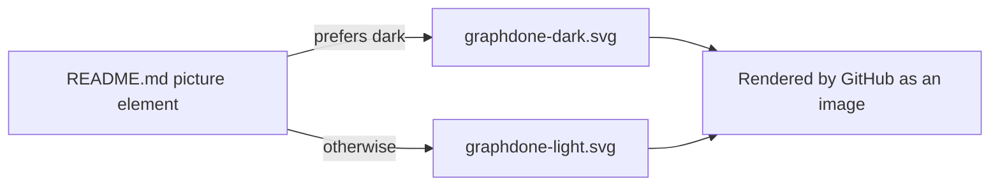

# `docs/img/hero/` — README banner

The animated banner at the top of the [repository README](../../../README.md). It
draws GraphDone's own open work as a small live graph: work items orbiting their
outcome (the logo), each owned by a person or an AI agent.

## What's here

| File | What it is |
| --- | --- |
| [`graphdone-dark.svg`](graphdone-dark.svg) | Banner for dark mode |
| [`graphdone-light.svg`](graphdone-light.svg) | Banner for light mode |

## Changing it

- The animation is CSS keyframes only, because GitHub shows SVGs as images and
  runs no scripts. Under `prefers-reduced-motion` it shows the finished frame.
- Text is drawn as shapes, so the banner looks the same without any fonts.
  Its `<title>` and the README's `alt` text are what screen readers get; keep
  them in step with the picture.
- Both files are generated by a script outside this repository (see commit
  `b9ef93b`), so regenerate them rather than editing the SVG by hand, and
  replace both files together.

Up: [`docs/img/`](../README.md)
