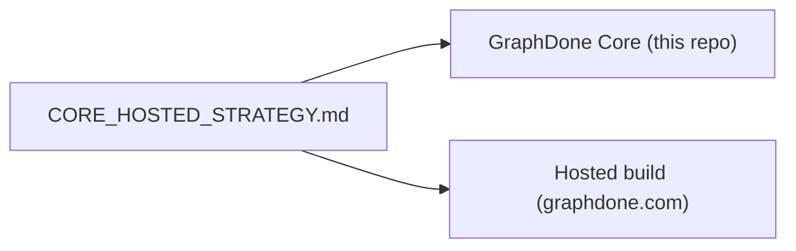

# `docs/product/` — product decisions

Decision records about what GraphDone is for and how Core relates to the hosted
build at graphdone.com.

## What's here

| File | What it is |
| --- | --- |
| [`CORE_HOSTED_STRATEGY.md`](CORE_HOSTED_STRATEGY.md) | Decision record (2026-09-08): people's work comes first, with dependable agent check-ins; replaces older "pet agent" and feature-gating proposals |

Up: [`docs/`](../README.md)
