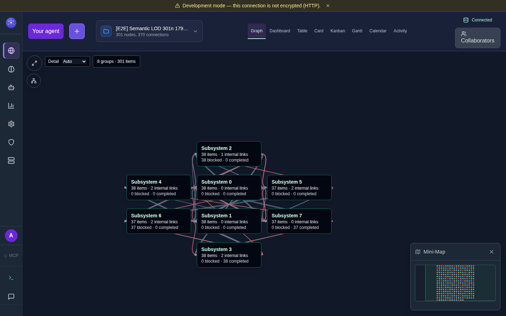
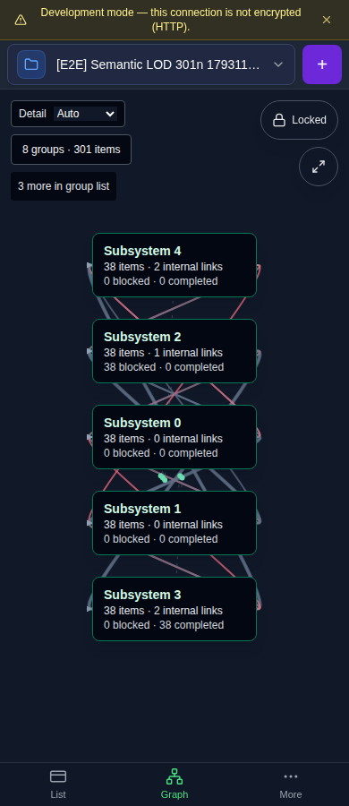

# Semantic overview validation — 2026-10-27

The first production-renderer slice adds readable overview groups and member
navigation. It does not complete the [dynamic LOD delivery plan](../architecture/dynamic-graph-lod.md).
CodeGraph supplied ideas; both projects keep independent implementations and no
shared library was introduced.

## Revisions and environment

- Base: `ef495eff15ed7aac51e72dc7a1db1bb96d2b3695`, also the live remote `dev`
  when rechecked on 2026-10-27.
- Implementation: `df5d1cab932985092d77c17826af9d5cfc0e94b0`.
- Bidirectional readability refinement: `8ddd573c6edd433b9106a445b60e7c8b45009164`.
- Final validation/test-enrollment head:
  `5f11f3bcc97fa3e90ffa1ea31f8e75f97a1ace16`. Its only application-source change
  from `8ddd573` removes an unsupported lint-rule directive; the runtime behavior
  is unchanged. Other changes enroll the browser tests in headed acceptance.
- Independent agent review found no outstanding findings at all three heads.
  This is not a GitHub non-author approval.
- Node 22.18.0, npm 10.8.2; clean `npm ci --no-audit --no-fund` installed 1,221
  packages. Dependencies and lockfile remain unchanged from the reviewed base.
- Chrome 151.0.7922.71, headed under Xvfb, one browser worker and zero retries.
  Phone coverage uses a 390×900 viewport and CDP touch emulation, not phone hardware.
- Owned Neo4j 5.26.12 container, built API on port 28527, isolated web on 28528.
  Tests never seeded or edited the owner's application on port 8540.

## Results

| Check | Result and revision |
| --- | --- |
| `npm run typecheck` | Pass, five tasks at `5f11f3b` |
| `npm run lint` | Pass, four tasks at `5f11f3b`; existing warnings remain |
| `npm run build` | Pass, four tasks at `5f11f3b` |
| `npm run perf:bundle` | Pass: largest gzipped JS chunk 265.8kB / 450kB budget |
| `npm run test -w @graphdone/web -- --maxWorkers=1 --minWorkers=1` | 335/335 across 41 files at `5f11f3b` |
| `node --test tests/lib/runner/unified-cli.test.mjs` | 25/25, zero skipped at `5f11f3b`; verifies LOD enrollment in the blocking new-user sequence |
| `semantic-lod.spec.ts` | 2/2 at `8ddd573`, 1440×900 and 390×900, 1.9 minutes |
| Existing `graph-motion`, `graph-resize`, `graph-details` specs | 7/7 at `df5d1ca`, 3.5 minutes; subsequent behavior changes only adjust the ≥40-item overview threshold, which these small-graph fixtures do not enter |
| `npm audit --omit=dev --audit-level=high` | **Fails**: 5 moderate / 1 high in the unchanged dependency tree; high finding is Undici 6.28.1. No dependency upgrade was folded into this feature. |

Run the focused browser suite with an owned stack and installed browser:

```sh
TEST_URL=http://127.0.0.1:28528 QC_BROWSER_PORT=28529 \
  xvfb-run --auto-servernum npm run qc:lod
```

The two browser journeys use **301 pinned items and 370 relationships**, with
eight explicit top-level groups and one long multiline title. This matches the
reviewed localhost graph's cardinality, not its private topology or content.
Assertions cover:

- 14px non-overlapping summary titles, complete group/member access including
  phone overflow, and the original source item in the inspector.
- Parent coverage while zooming in through 1.1; item titles ≥12px at 1.2, then
  while zooming out through 1.14 and 1.01; summaries return at 0.99.
- Real wheel input and mouse pan over summary cards; real CDP touch pan/pinch;
  keyboard open/Escape, inspection, Back, and focus restoration.
- Forced Overview at normal item scale hides source groups and arrows from
  painting/hit testing; source filters remain in D3-owned definitions.
- The same SVG survives representation changes within a graph. The existing app
  may replace it when changing graphs. A→B→A starts a fresh inspection session
  and Back restores the new entry camera exactly.
- Zero attempted GraphQL mutations during guarded navigation; exact source
  positions and IDs before/after navigation and reload; zero page errors.

The pure projection tests additionally conserve every directed, typed edge,
including parallel/reverse edges, internal links, self-loops and missing endpoints;
they exercise native containment, cycles, conflicting parents, malformed metadata,
stable membership and untouched canonical objects.

## Screenshots

These are synthetic owned fixtures captured from the production component.





## Failures retained and corrections

Local raw evidence remains in the owned worktree's ignored
`test-artifacts/lod-evidence/`. The records include:

1. A watched API restarted during a concurrent Core rebuild, and 100-input
   Neo4j create batches exceeded fixture setup time. Use the stable built API
   and repeated 20-input batches; retain the full 301/370 dataset.
2. Member selection moved the camera but lost the inspector when the detached
   click target reached the document outside-click handler. The overview stops
   click propagation; both viewport regressions subsequently passed.
3. A default-camera refresh on startup could prevent initial fit. Refresh title
   geometry only when leaving Overview in the same graph scope.
4. The graph-switch test initially assumed its selector closed automatically;
   the existing selector intentionally stays open. The test now closes it with
   Escape. A later assertion incorrectly demanded the same SVG across different
   graphs; identity is now checked within each graph's LOD navigation session.
5. The unconstrained parallel unit run had a 16ms timing assertion fail and a
   5s UI timeout under load. Sequential workers passed all 335 tests, with the
   original failures retained.
6. Final lint rejected a suppression for a plugin rule this repo does not load.
   Removing that directive fixed lint without changing runtime behavior.

See the [renderer-ownership lesson](../../.agents/inbox/2026-10-27-lod-projections-need-renderer-ownership.md)
for causes and corrective rules.

## Cleanup and remaining gates

The owned API/web processes, Neo4j container and anonymous volumes were removed.
Owned SQLite authentication/operations databases were removed after process exit.
The owner's original localhost app still returned HTTP 200 afterward. Other
worktrees, CodeGraph source, main, deployments and repository protections were
unchanged by this work.

This is not merge or release readiness: the production audit is red, full remote
branch CI and broader integration/image/installer gates have not been established,
and no deployment has been performed. This slice still constructs the complete
source SVG and loads full graph snapshots. Nested spatial expansion, local density
budgets, summary-first loading, Cloud parity and measured 1k/10k capacity remain
on the delivery plan. Existing autosave of newly laid-out/overlapping source nodes
is not fixed by the zero-write test on pinned, non-overlapping fixtures.
