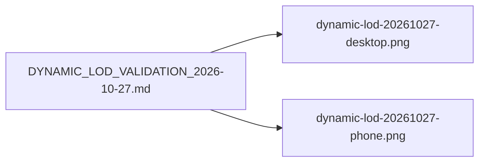

# `docs/quality/images/` — evidence screenshots

Screenshots embedded in the quality records, kept next to them.

## What's here

| File | What it shows |
| --- | --- |
| [`dynamic-lod-20261027-desktop.png`](dynamic-lod-20261027-desktop.png) | The semantic overview on desktop, 2026-10-27 |
| [`dynamic-lod-20261027-phone.png`](dynamic-lod-20261027-phone.png) | The same overview on a phone |

Up: [`docs/quality/`](../README.md)
