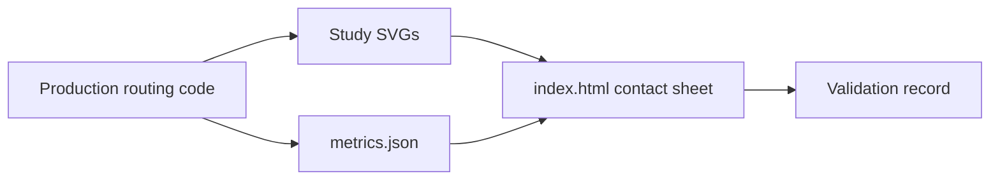

# `docs/quality/schematic-routing-study/` — wire-routing studies

A small static page with SVG studies of how the router draws connections in hard
cases. It is evidence for
[`SCHEMATIC_ROUTING_VALIDATION_2026-10-28.md`](../SCHEMATIC_ROUTING_VALIDATION_2026-10-28.md).

## What's here

| File | What it is |
| --- | --- |
| [`index.html`](index.html) | Contact sheet: open it in a browser to see all studies with notes |
| [`chain.svg`](chain.svg) | A chain of dependent items |
| [`dense-cycle.svg`](dense-cycle.svg) | A tightly connected cycle |
| [`fanout.svg`](fanout.svg) | One item fanning out to many |
| [`phone.svg`](phone.svg) | A study at phone width |
| [`metrics.json`](metrics.json) | Measured crossings, overlaps and card intersections for each study |

Up: [`docs/quality/`](../README.md)
