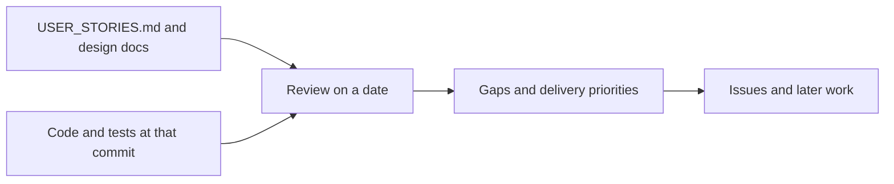

# `docs/reviews/` — state-of-the-project reviews

Dated snapshots of how far the product had got against its vision, area by area,
with what was still missing. A review describes the code on the date it names;
check [`../SYSTEMS.md`](../SYSTEMS.md) and the open issues for what is true now.

## What's here

| File | What it is |
| --- | --- |
| [`2026-09-07-state.md`](2026-09-07-state.md) | Area-by-area state (canvas, responsive editing, analytics, agents, ontology, activity, collaboration, admin, hosted build), the evidence for each, and five delivery priorities |

Up: [`docs/`](../README.md)
