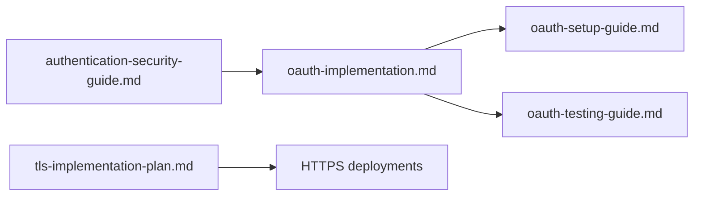

# `docs/security/` — authentication, OAuth and TLS

How sign-in and transport security work and how to set them up and test them.

## What's here

| File | What it covers |
| --- | --- |
| [`authentication-security-guide.md`](authentication-security-guide.md) | How authentication is protected, with pointers to dated evidence |
| [`oauth-implementation.md`](oauth-implementation.md) | OAuth 2.0 login, checked against each provider's specification |
| [`oauth-setup-guide.md`](oauth-setup-guide.md) | Setting up Google, LinkedIn and GitHub sign-in |
| [`oauth-testing-guide.md`](oauth-testing-guide.md) | Testing the OAuth flows |
| [`tls-implementation-plan.md`](tls-implementation-plan.md) | HTTPS, certificates and secrets for production |

Up: [`docs/`](../README.md)
