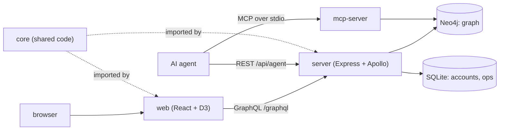

# `packages/` — the product code (npm workspaces)

Everything that ships as GraphDone lives here, split into four npm workspaces.
The browser app talks GraphQL to the API server; AI agents talk to the graph
either through the API's agent routes or through the MCP server. The root
`package.json` builds and tests all four together with Turbo.



## What's here

| Path | What it is | Start reading at |
| --- | --- | --- |
| [`web/`](web/README.md) | `@graphdone/web`: the single-page app. Graph canvas, list/kanban/gantt views, sign-in, admin. With offline sync enabled (the hosted build at graphdone.com), guests work in a browser-local IndexedDB workspace. | [`web/src/App.tsx`](web/src/App.tsx) |
| [`server/`](server/README.md) | `@graphdone/server`: the API. GraphQL over Neo4j for work items, SQLite for users and sessions, plus auth, agent and operations routes. Falls back to an auth-only mode when Neo4j is down. | [`server/src/index.ts`](server/src/index.ts) |
| [`mcp-server/`](mcp-server/README.md) | `@graphdone/mcp-server`: Model Context Protocol tools so an agent such as Claude Code can browse and edit the graph in Neo4j. | [`mcp-server/src/index.ts`](mcp-server/src/index.ts) |
| [`core/`](core/README.md) | `@graphdone/core`: shared TypeScript (graph model, priority maths, agent contract, operations service). | [`core/src/index.ts`](core/src/index.ts) |

`core` is built first: Turbo's `build` task depends on `^build`, and `test` on `build`.

## How to run / use

From the repo root:

```bash
npm run build          # turbo run build, all workspaces
npm run test           # turbo run test, vitest in each workspace
npm run lint
npm run typecheck
npm run test -w @graphdone/web   # one workspace only
```

To run the whole stack, use the root `./start` launcher described in the
[root README](../README.md). Cross-package and browser tests live in
[`tests/`](../tests/README.md), not here.

Up: [repo root](../README.md)
