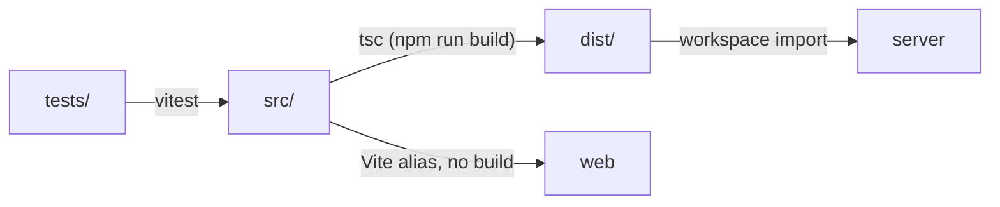

# `packages/core/` — shared library (`@graphdone/core`)

Plain TypeScript that more than one package needs, kept here so the server and
the browser follow the same rules. It has no UI and no HTTP code.

Today the other packages import four things from it:

| Used by | Import | Why |
| --- | --- | --- |
| [`server/src/agent-api.ts`](../server/src/agent-api.ts) | `agentDiscovery` | The `/api/agent/discovery` document agents read first. |
| [`server/src/operations-api.ts`](../server/src/operations-api.ts) | `OperationsService`, `OPS_SCHEMA` (from `dist/operations.js`) | Feedback and operator review stored in SQLite. |
| [`web/src/components/AgentConnection.tsx`](../web/src/components/AgentConnection.tsx) | `buildAgentPrompt` | The prompt a user copies to connect an agent. |
| [`web/src/lib/offline/link.ts`](../web/src/lib/offline/link.ts) | `taskAssignee` | Reads an item's display assignee in the browser-local workspace. |

The graph model (`Graph`, `Node`, `Edge`, `PriorityCalculator`, `Neo4jGraph`)
is exported too, but no other package imports it at present; the server's
GraphQL schema reads and writes Neo4j directly.



## What's here

| Path | What it is |
| --- | --- |
| [`src/`](src/README.md) | Library source; [`src/index.ts`](src/index.ts) is the public entry point. |
| [`tests/`](tests/README.md) | Vitest unit tests for the graph model and priority maths. |
| [`package.json`](package.json) | Builds `src/` to `dist/` with `tsc`; depends on `uuid` and `neo4j-driver`. |
| [`vitest.config.ts`](vitest.config.ts), `tsconfig.json`, `eslint.config.js` | Test, compiler and lint settings. |

`dist/` is build output and is git-ignored. Because the server loads `dist/`,
build `core` before running the server (Turbo does this for `npm run build`).

## How to run / use

```bash
npm run build -w @graphdone/core       # tsc -> dist/
npm run test -w @graphdone/core        # vitest --run
npm run typecheck -w @graphdone/core
```

Next: read [`src/`](src/README.md) for what each file does.

Up: [`packages/`](../README.md)
