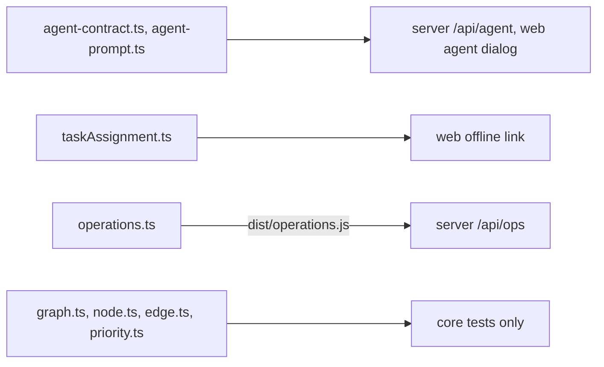

# `packages/core/src/` — core library source

The source of `@graphdone/core`. It holds two kinds of code: small contracts
that the server and web app really use, and the in-memory graph model that the
unit tests exercise. Start at [`index.ts`](index.ts), which lists every export.

## What's here

| Path | What it is |
| --- | --- |
| [`index.ts`](index.ts) | Public exports. Everything below except `operations.ts`. |
| [`agent-contract.ts`](agent-contract.ts) | `agentDiscovery`: the machine-readable agent API description (routes, limits, recovery rules), shared by hosted and self-hosted builds. `agentLimits` turns usage into remaining allowance (not imported in this repo). |
| [`agent-prompt.ts`](agent-prompt.ts) | `buildAgentPrompt`: the text the UI copies so an agent can connect to one project. |
| [`taskAssignment.ts`](taskAssignment.ts) | `taskAssignee`: reads the display assignee from item metadata. Display only, never an access grant. |
| [`operations.ts`](operations.ts) | `OperationsService` and `OPS_SCHEMA`: user feedback, operator review, scoped operator tokens and a public announcement, over a small SQL database. Not re-exported from `index.ts`; the server imports `dist/operations.js` directly. |
| [`types.ts`](types.ts) | Ids, enums (`NodeType`, `NodeStatus`, `EdgeType`, `ContributorType`) and graph interfaces. |
| [`graph.ts`](graph.ts) | `Graph`: in-memory nodes and edges, neighbours, dependencies, filters, `findPath`, `detectCycles`. |
| [`node.ts`](node.ts), [`edge.ts`](edge.ts) | `Node` (a work item with a spherical position set by its priority) and `Edge` (a typed link). |
| [`priority.ts`](priority.ts) | `PriorityCalculator`: computed priority, radius from priority, priority migration. |
| [`neo4j-graph.ts`](neo4j-graph.ts) | `Neo4jGraph`: the graph operations over a Neo4j session. Exported but not used by another package. |

Next: the tests for the model are in [`../tests/`](../tests/README.md).

Up: [`packages/core/`](../README.md)
