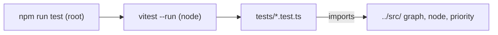

# `packages/core/tests/` — core unit tests

Vitest unit tests for the in-memory graph model in [`../src/`](../src/README.md).
They run in Node with no database or browser, so they are the quickest way to
check a change to `graph.ts`, `node.ts` or `priority.ts`.



## What's here

| Path | What it covers |
| --- | --- |
| [`graph.test.ts`](graph.test.ts) | `Graph`: node and edge operations, traversal (paths, dependencies), cycle detection, serialization. |
| [`node.test.ts`](node.test.ts) | `Node`: constructor defaults, priority and status updates, contributors, dependencies, `toJSON`. |
| [`priority.test.ts`](priority.test.ts) | `PriorityCalculator`: `calculate`, `calculateRadiusFromPriority`, `migratePriority`. |

The agent contract and `operations.ts` have no unit tests here. Operations are
exercised end to end through the API by
[`tests/e2e/quality/operations.spec.ts`](../../../tests/e2e/quality/operations.spec.ts).

## How to run / use

```bash
npm run test -w @graphdone/core           # vitest --run
npm run test:coverage -w @graphdone/core  # v8 coverage of src/
```

Up: [`packages/core/`](../README.md)
