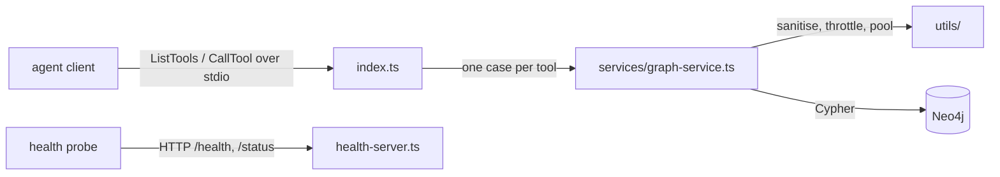

# `packages/mcp-server/src/` — MCP server source

The source of `@graphdone/mcp-server`. It exists so an AI agent can work on the
GraphDone graph with named tools instead of raw queries. The agent's client
(for example Claude Code) starts the built `dist/index.js` and talks to it over
stdio; the server reads and writes Neo4j directly, not through the GraphQL API.



## What's here

| Path | What it is |
| --- | --- |
| [`index.ts`](index.ts) | Start here. Connects to Neo4j (`NEO4J_URI`, `NEO4J_USER`, `NEO4J_PASSWORD`), declares the tool list (31 tools: `browse_graph`, node and edge CRUD, `find_path`, priorities, workload and contributor tools, `suggest_task_assignment`, graph create/list/update/archive/clone/delete, `get_graph_context`) and switches each call to a `GraphService` method. `detect_cycles` is present but commented out. |
| [`health-server.ts`](health-server.ts) | A small HTTP server on `MCP_HEALTH_PORT` (default 3128) with `/health` and `/status`; counts tool calls and client connections. |
| [`services/`](services/README.md) | `GraphService`, where every tool's Cypher lives, and the pure assignment-ranking code. |
| [`types/`](types/README.md) | Enums and argument types shared by the tools. |
| [`utils/`](utils/README.md) | Guards every database call passes through: input sanitising, CPU and memory limits, connection pool, consistency, ids. |

To add or change a tool: add its schema and `case` in `index.ts`, its method in
`services/graph-service.ts`, and a test in [`../tests/`](../tests/README.md).

## How to run / use

```bash
npm run build -w @graphdone/mcp-server       # tsc -> dist/
npm run dev:start -w @graphdone/mcp-server   # tsx watch src/index.ts
npm run dev:mcp                               # the same, from the repo root
```

Setting it up in an agent client is covered in the [package README](../README.md).

Up: [`packages/mcp-server/`](../README.md)
