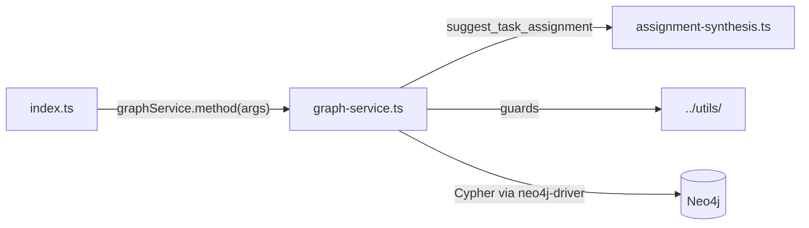

# `packages/mcp-server/src/services/` — what each MCP tool does

`index.ts` only routes tool calls; the behaviour lives here. Read this folder to
find the Cypher a tool runs or to change what it returns.

## What's here

| Path | What it is |
| --- | --- |
| [`graph-service.ts`](graph-service.ts) | `GraphService`: one method per tool (about 3,900 lines). Each method runs inside `withSession` (stress check, CPU throttling, connection-pool limit), sanitises its arguments and, for writes, uses `withWriteConsistency`. Creating a node with `metadata.role = "coordinator"` goes through leader election. Also exports the tool argument types. |
| [`assignment-synthesis.ts`](assignment-synthesis.ts) | Pure ranking for `suggest_task_assignment`: scores contributors against open tasks from expertise, capacity and weights. No database access, so it is unit-tested directly. |

Tests: [`../../tests/`](../../tests/README.md) (`mcp-server.test.ts`,
`graph-operations.test.ts`, `assignment-synthesis.test.ts`).

Up: [`src/`](../README.md)
