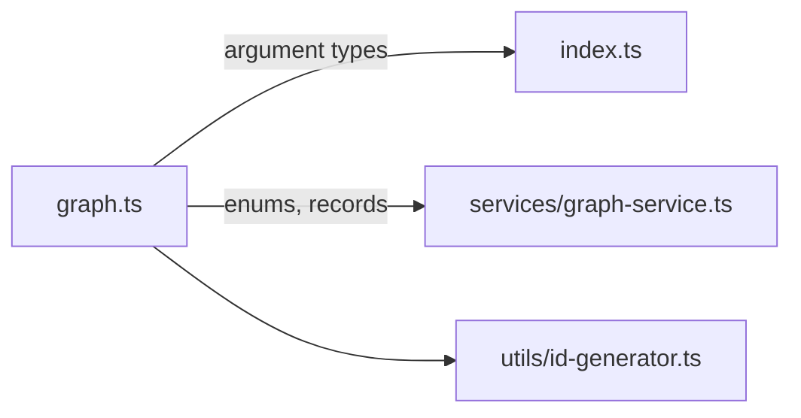

# `packages/mcp-server/src/types/` — tool types

One file of TypeScript types so the tool entry point, the graph service and the
id generator agree on what a node, edge or graph looks like and what each tool
accepts. There is no runtime code here.

## What's here

| Path | What it is |
| --- | --- |
| [`graph.ts`](graph.ts) | Enums (`NodeType`, `NodeStatus`, `EdgeType`, `GraphType`, `GraphStatus`), Neo4j record shapes, and argument types for the priority, contributor, bulk and graph-management tools. |

These enums are the MCP server's own copy; the web app's labels and colours for
the same values live in `packages/web/src/constants/workItemConstants.tsx`.

Up: [`src/`](../README.md)
