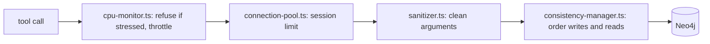

# `packages/mcp-server/src/utils/` — guards around every database call

An agent can call tools fast, in bulk and with odd input. These helpers keep
that safe: they clean the input, refuse or slow work when the host is busy,
cap concurrent Neo4j sessions and order reads after writes. `GraphService`
wraps each tool in them; `index.ts` uses the memory monitor.

The order above is the one in `GraphService.withSession` and its write methods
(for example `createNode`).

## What's here

| Path | What it is |
| --- | --- |
| [`sanitizer.ts`](sanitizer.ts) | Cleans HTML, strings, ids, metadata, node types, statuses and priorities, and bounds bulk sizes. |
| [`cpu-monitor.ts`](cpu-monitor.ts) | `CPUMonitor`, `withCPUThrottling`, `isSystemUnderStress`. Background notes: [`../../CPU_THROTTLING.md`](../../CPU_THROTTLING.md). |
| [`connection-pool.ts`](connection-pool.ts) | `withConnectionPoolLimit`: caps concurrent Neo4j sessions. |
| [`consistency-manager.ts`](consistency-manager.ts) | `withWriteConsistency` / `withReadConsistency`: a read of an id waits for pending writes to it. |
| [`memory-monitor.ts`](memory-monitor.ts) | Periodic memory checks and size-limited JSON parse/stringify; started from `index.ts`. |
| [`id-generator.ts`](id-generator.ts) | Collision-resistant node, edge, graph and session ids. |
| [`leader-election.ts`](leader-election.ts) | `electCoordinator`: a simplified Raft-like election, used when an agent creates a coordinator node. |

Up: [`src/`](../README.md)
