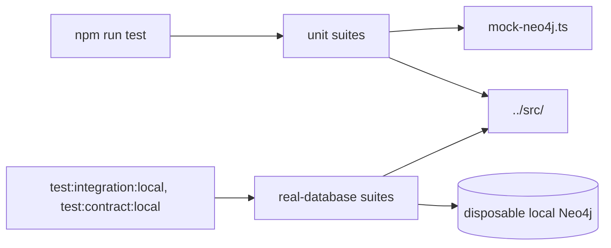

# `packages/mcp-server/tests/` — MCP server tests

Vitest tests for the MCP server. The default run uses a mock Neo4j driver, so
it needs no database; that is what `npm run test` runs. Three suites
talk to a real Neo4j and skip themselves unless you opt in with environment
variables, and they only accept a disposable database on localhost.



## What's here

| Path | What it covers |
| --- | --- |
| [`mcp-server.test.ts`](mcp-server.test.ts), [`graph-operations.test.ts`](graph-operations.test.ts) | `GraphService` on the mock driver: node and contributor operations, priorities, graph management. |
| [`mcp-protocol.test.ts`](mcp-protocol.test.ts) | Tool names, descriptions and input schemas follow MCP rules. |
| [`graph-context.test.ts`](graph-context.test.ts) | `get_graph_context` stays compact: counts, top blockers, recent activity, under 2 kB. |
| [`assignment-synthesis.test.ts`](assignment-synthesis.test.ts) | The ranking behind `suggest_task_assignment`. |
| [`health-server.test.ts`](health-server.test.ts) | `/health` and `/status`. |
| [`cpu-monitor.test.ts`](cpu-monitor.test.ts) | CPU protection with fixed CPU samples. |
| [`zod-sdk-compatibility.test.ts`](zod-sdk-compatibility.test.ts) | Zod collection parsing with the installed MCP SDK, over an in-memory transport. |
| [`real-database-integration.test.ts`](real-database-integration.test.ts), [`mock-validation.test.ts`](mock-validation.test.ts) | Real Neo4j; checks the mock answers like the real database. Need `GRAPHDONE_DISPOSABLE_NEO4J=1` plus `NEO4J_URI` (loopback), `NEO4J_USER`, `NEO4J_PASSWORD`. |
| [`neo4j-contract.test.ts`](neo4j-contract.test.ts) | The service's own Cypher against a real Neo4j. Needs `RUN_DB_CONTRACT=1` and a disposable local fixture. |
| `mock-neo4j.ts`, `stable-cpu.ts`, `test-tools.ts` | Helpers: the mock driver, fixed CPU samples, a subset of tool definitions. |

Tests run one file at a time in forked processes (`vitest.config.ts`).

## How to run / use

```bash
npm run test -w @graphdone/mcp-server                    # mock-backed suites
npm run test:integration:local -w @graphdone/mcp-server  # real Neo4j (env above)
npm run test:contract:local -w @graphdone/mcp-server     # Cypher contract
```

Up: [`packages/mcp-server/`](../README.md)
