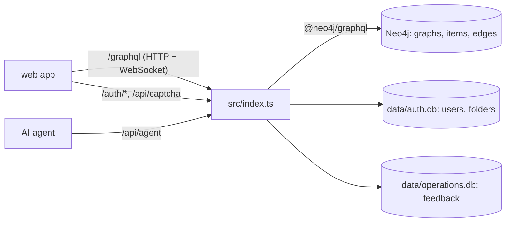

# `packages/server/` — GraphQL API (`@graphdone/server`)

The backend for a self-hosted GraphDone. One Express process serves the GraphQL
API the web app uses, the sign-in routes, a REST API for AI agents and an
operations API for feedback. Work items and their relationships live in Neo4j;
users, sessions, folders and operator data live in local SQLite files.



If Neo4j is unreachable at start-up the server still runs in **auth-only
mode**: sign-in and user management work, work items do not.

## What's here

| Path | What it is |
| --- | --- |
| [`src/`](src/README.md) | The server source. Start at [`src/index.ts`](src/index.ts). |
| [`tests/`](tests/README.md) | Vitest tests for the auth, CAPTCHA, OAuth and start-up boundaries. |
| [`package.json`](package.json) | Scripts below; dependencies include Apollo Server, `@neo4j/graphql`, Passport, `sqlite3`, `altcha-lib`, `nodemailer`. |
| [`EMAIL_SETUP.md`](EMAIL_SETUP.md) | How to configure SMTP so magic-link and password-reset emails are sent. |
| `Dockerfile`, `Dockerfile.dev` | Production image (used by `deployment/docker-compose.yml` and CI) and development image (`deployment/docker-compose.dev.yml`). |
| `.env.example` | Sample environment file. Its `DATABASE_URL` and `AUTH0_*` entries are not read by the current code; the variables that matter are `NEO4J_*`, `JWT_SECRET`, `SESSION_SECRET`, `PORT` and the OAuth, email and TLS settings described in `src/`. |
| `vitest.config.ts`, `tsconfig.json`, `eslint.config.js` | Test, compiler and lint settings. |

At run time the server creates `data/` (git-ignored) in its working directory
for the SQLite files.

## How to run / use

```bash
npm run dev -w @graphdone/server        # tsx watch src/dev.ts (NODE_ENV=development)
npm run build -w @graphdone/server      # tsc -> dist/
npm run start -w @graphdone/server      # node dist/index.js
npm run test -w @graphdone/server       # vitest --run
npm run db:seed -w @graphdone/server    # wipe Neo4j and load sample data
```

The API listens on `PORT` (default 4127). The usual way to run the whole stack
is the root `./start` launcher; see the [root README](../../README.md) and
[`deployment/`](../../deployment/README.md).

Up: [`packages/`](../README.md)
