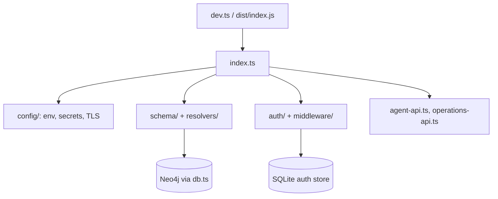

# `packages/server/src/` — server source

Everything the API process runs. [`index.ts`](index.ts) is the place to start:
it loads config, opens SQLite and Neo4j, builds the GraphQL schema, mounts every
HTTP route and starts listening.

## What's here

| Path | What it is |
| --- | --- |
| [`index.ts`](index.ts) | Builds the Express app: sessions, Passport, rate limits, `/graphql` (Apollo, HTTP and WebSocket), `/health`, `/config`, `/mcp/status`, `/auth/*` (OAuth, magic link, password reset), `/share/*`, `/api/captcha/challenge`, then mounts the two REST routers. Falls back to an auth-only schema when Neo4j fails. |
| [`dev.ts`](dev.ts) | Development entry (`npm run dev`): sets `NODE_ENV=development`, then loads `index.ts`. |
| [`db.ts`](db.ts) | The shared Neo4j driver from `NEO4J_URI`, `NEO4J_USER`, `NEO4J_PASSWORD`. |
| [`agent-api.ts`](agent-api.ts) | `/api/agent`: REST for AI agents with project-scoped credentials (`/discovery`, `/limits`, `/usage`, `/context`, `/items`, `/notes`, `/tokens`). Agent credentials never grant account access. |
| [`operations-api.ts`](operations-api.ts) | `/api/ops`: user feedback and operator review, using `OperationsService` from `@graphdone/core` over `data/operations.db`. |
| [`context.ts`](context.ts) | A `createContext` helper. Not imported anywhere; `index.ts` builds its own context. |
| [`auth/`](auth/README.md) | Accounts: SQLite store, OAuth, magic links, email, login limits, folder access, WebSocket auth. |
| [`config/`](config/README.md) | Environment loading, production secret checks, TLS. |
| [`middleware/`](middleware/README.md) | Bearer-token checks used by GraphQL, REST and WebSocket. |
| [`resolvers/`](resolvers/README.md) | Hand-written GraphQL resolvers added on top of the generated Neo4j ones. |
| [`schema/`](schema/README.md) | GraphQL type definitions (Neo4j, auth, auth-only). |
| [`routes/`](routes/README.md) | An older Express auth router, not mounted. |
| [`services/`](services/README.md) | Code that writes starter graphs (Welcome graph, hierarchy demo) to Neo4j. |
| [`scripts/`](scripts/README.md) | `npm run` scripts: seed, welcome graphs, hierarchy demo, admin check. |
| [`types/`](types/README.md) | Type declarations for untyped or augmented libraries. |
| [`utils/`](utils/README.md) | JWT helpers and the ALTCHA CAPTCHA service. |

Next: to follow a request, read `index.ts`, then [`middleware/auth.ts`](middleware/auth.ts)
and [`resolvers/sqlite-auth.ts`](resolvers/sqlite-auth.ts).

Up: [`packages/server/`](../README.md)
