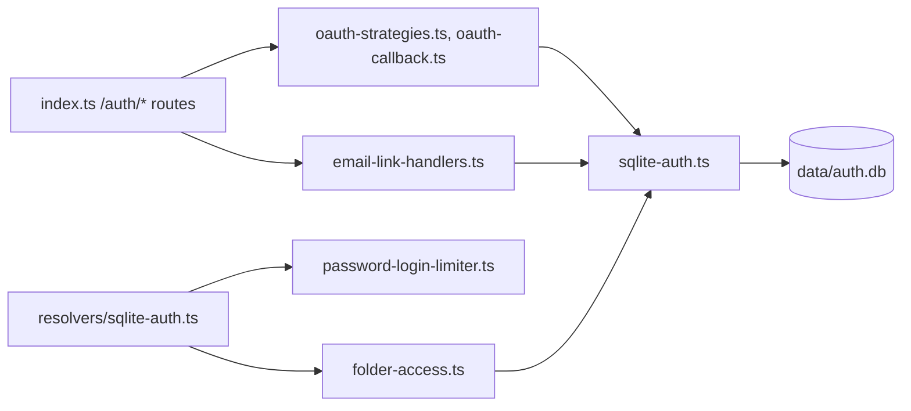

# `packages/server/src/auth/` — accounts and sign-in

Who a user is and what they may touch. Accounts, teams, folders, OAuth
providers, magic links and share links are stored in SQLite
(`data/auth.db`) so sign-in still works when Neo4j is down. The GraphQL
resolvers in [`../resolvers/sqlite-auth.ts`](../resolvers/sqlite-auth.ts) and
the routes in [`../index.ts`](../index.ts) call into this folder.

## What's here

| Path | What it is |
| --- | --- |
| [`sqlite-auth.ts`](sqlite-auth.ts) | Start here. `sqliteAuthStore`: creates the tables (`users`, `teams`, `folders`, `graph_folders`, `oauth_providers`, `magic_links`, `shareable_links` and more) and all user, password, link and folder operations. |
| [`oauth-strategies.ts`](oauth-strategies.ts) | Registers the Passport strategies for Google, GitHub and LinkedIn (LinkedIn through `passport-openidconnect`) when their credentials are configured. |
| [`oauth-profile-fetch.ts`](oauth-profile-fetch.ts), [`oauth-identity.ts`](oauth-identity.ts) | Fetch and validate provider profiles; only verified provider emails count. |
| [`oauth-account.ts`](oauth-account.ts) | Links a validated OAuth identity to an existing or new local user. |
| [`oauth-callback.ts`](oauth-callback.ts) | The shared OAuth callback: issues the JWT and redirects back to the web app. |
| [`email-link-handlers.ts`](email-link-handlers.ts) | Handlers for magic-link sign-in and password reset links (single use, purpose-bound, CAPTCHA checked). |
| [`email-service.ts`](email-service.ts) | Sends those emails through nodemailer when `EMAIL_USER` / `EMAIL_PASS` are set; see [`../../EMAIL_SETUP.md`](../../EMAIL_SETUP.md). |
| [`password-login-limiter.ts`](password-login-limiter.ts) | Bounded per-key counting of failed password logins. |
| [`folder-access.ts`](folder-access.ts) | Who may read, create, move or delete folders and the graphs inside them. |
| [`graph-identity.ts`](graph-identity.ts) | Mirrors a signed-in SQLite user into Neo4j so items can record owner and assignee. |
| [`websocket-auth.ts`](websocket-auth.ts) | `graphql-ws` guard: when a bearer token is sent, checks it on connect and again before each result, and closes the socket when the session has expired. |

Tests for this folder are in [`../../tests/`](../../tests/README.md)
(`magic-link`, `oauth-*`, `password-login-*`, `folder-authorization`, `auth-link-boundary`).

Up: [`src/`](../README.md)
