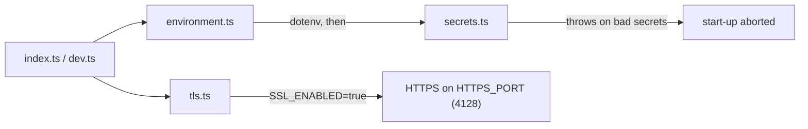

# `packages/server/src/config/` — start-up configuration

Settings the server needs before it can accept a request: environment
variables, a refusal to start in production with placeholder secrets, and the
optional HTTPS setup. [`../index.ts`](../index.ts) and [`../dev.ts`](../dev.ts)
import `environment.ts` first, so the secret check runs before anything else.

## What's here

| Path | What it is |
| --- | --- |
| [`environment.ts`](environment.ts) | Loads `.env` with dotenv, then runs `validateProductionSecrets`. |
| [`secrets.ts`](secrets.ts) | In production, rejects a missing or known-placeholder `JWT_SECRET` or `SESSION_SECRET`, and a short `ALTCHA_HMAC_KEY`. |
| [`tls.ts`](tls.ts) | `createTlsConfig` / `validateTlsConfig`: reads `SSL_ENABLED`, `SSL_KEY_PATH`, `SSL_CERT_PATH`, `HTTPS_PORT` and loads the key and certificate. |
| [`tls.test.ts`](tls.test.ts) | Vitest tests for `tls.ts` with a mocked file system. |
| [`passport.ts`](passport.ts) | An older `configurePassport` with its strategies commented out. Not imported; OAuth is set up by [`../auth/oauth-strategies.ts`](../auth/oauth-strategies.ts). |

Certificate setup for a real deployment is described in
[`docs/tls-ssl-setup.md`](../../../../docs/tls-ssl-setup.md).

Up: [`src/`](../README.md)
