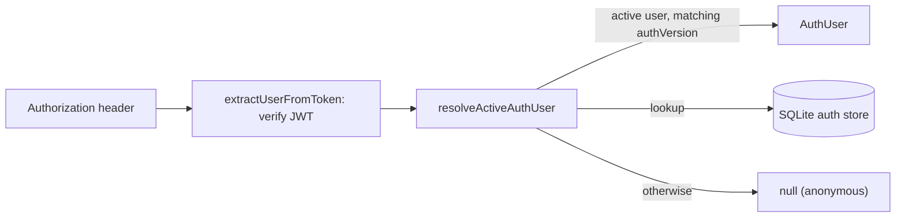

# `packages/server/src/middleware/` — who is calling

One file that turns an `Authorization: Bearer <jwt>` header into a user. Every
entry point uses it: the GraphQL context in [`../index.ts`](../index.ts), the
agent and operations routers, and the WebSocket guard in
[`../auth/websocket-auth.ts`](../auth/websocket-auth.ts).

## What's here

| Path | What it is |
| --- | --- |
| [`auth.ts`](auth.ts) | `extractUserFromToken` (checks the JWT shape and signature via [`../utils/auth.ts`](../utils/auth.ts)); `resolveActiveAuthUser` (the account must still be active and its `authVersion` must match, so changing or resetting a password, or deactivating the account, revokes older tokens; well-formed guest ids are accepted without an account); `requireAuth` / `requireRole` helpers (not used outside this file at present). |

Up: [`src/`](../README.md)
