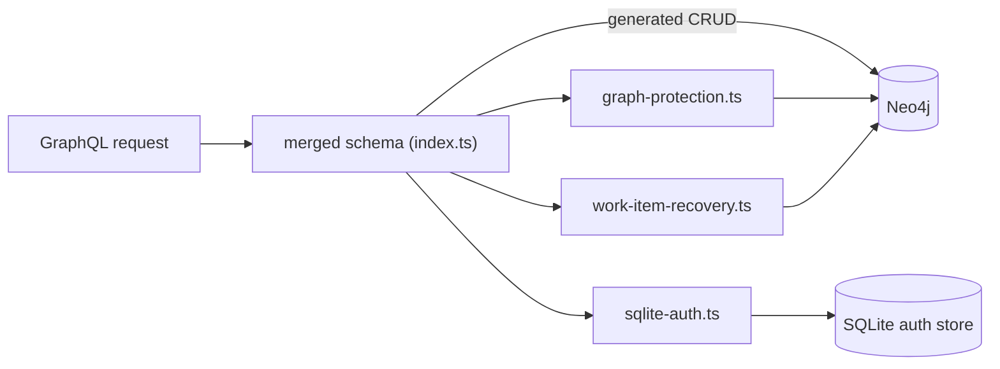

# `packages/server/src/resolvers/` — hand-written GraphQL resolvers

Most of the GraphQL API is generated by `@neo4j/graphql` from the type
definitions in [`../schema/`](../schema/README.md). This folder holds the
resolvers that cannot be generated: everything backed by SQLite (accounts,
folders, settings) and a few Neo4j mutations that need extra checks.
[`../index.ts`](../index.ts) merges them into the schema.

## What's here

| Path | What it is |
| --- | --- |
| [`sqlite-auth.ts`](sqlite-auth.ts) | Start here. Queries such as `me`, `users`, `folders`, `systemSettings`, `oauthProviderConfigs`; mutations `login`, `guestLogin`, `signup`, `logout`, `refreshToken`, user admin, folder management and OAuth provider config. Applies CAPTCHA and the password-login limiter. Also the whole schema in auth-only mode. |
| [`graph-protection.ts`](graph-protection.ts) | Overrides `deleteGraphs` so protected graphs (the shared Welcome graph) cannot be deleted, and a graph that still holds graphs (by `parentGraphId` or `PARENT_OF`) is refused unless they are deleted with it. |
| [`work-item-recovery.ts`](work-item-recovery.ts) | `restoreWorkItem`: puts a deleted task back with its original id when a user undoes a delete; validates every field and requires a USER or ADMIN role. |
| [`auth.ts`](auth.ts) | `authResolvers`: an older, larger resolver set. Not imported anywhere. |

Up: [`src/`](../README.md)
